# 07-week-7-clean-architecture

## Tujuan

1. Menjelaskan prinsip SOLID dan separation of concerns dengan contoh kode Flutter.
2. Membedakan struktur feature-first vs layer-first beserta trade-off-nya.
3. Menjelaskan tiga layer (presentation, domain, data) dan aturan dependensi (dependensi mengarah ke dalam).
4. Membedakan entity vs model serta peran repository, use case, dan dependency injection.
5. Merefactor project Minggu 5/6 menjadi struktur feature-first yang terpisah layer-nya.
6. Menguji use case dengan repository palsu tanpa database atau jaringan sungguhan.

## Praktikum 1: Audit Layer Project Lama

| File | Layer saat ini | Masalah / Catatan Audit |
| --- | --- | --- |
| pages/home_page.dart | Presentation | Sudah berfokus pada tampilan, navigasi, dan pemanggilan logout melalui notifier. Tidak ditemukan akses Dio, database, penyimpanan token, parsing JSON, atau pemformatan tanggal di widget. Navigasi sudah menggunakan konstanta AppRoutes. Tidak ditemukan pelanggaran pemisahan layer pada file ini. |
| data/api_client.dart | Data / Infrastruktur jaringan | Mengatur Dio, header autentikasi, dan interceptor refresh token. Masih bergantung pada kelas konkret AuthRepository dan TokenStore. Base URL masih berupa alamat contoh yang ditulis langsung dalam kode. Retry setelah respons 401 belum memiliki batas percobaan sehingga berisiko melakukan refresh berulang. Belum ada pengaturan untuk mencegah beberapa request 401 melakukan refresh secara bersamaan. Pemakaian API client perlu ditelusuri pada file lain untuk memastikan widget tidak mengaksesnya langsung. |
| providers/auth_provider.dart | Presentation (state) + DI | Provider membuat TokenStore dan AuthRepository secara langsung serta menyediakan Dio. AuthNotifier membaca, menyimpan, dan menghapus token langsung melalui TokenStore, sehingga pengelolaan sesi masih bercampur dengan pengelolaan state UI. |
| data/auth_repository.dart | Data + model sesi + logika autentikasi | AuthRepository berupa kelas konkret tanpa interface domain terpisah. AuthSession, validasi input, serta simulasi login dan refresh masih berada dalam satu file. |


Menandai tiga pelanggaran klasik, dengan melakukan grep di project.

Berikut merupakan hasil tiga pola pelanggaran klasik

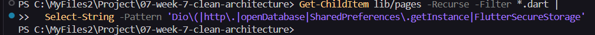

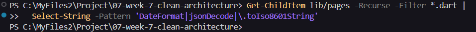

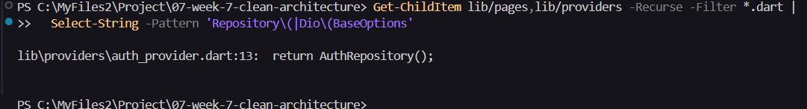

Pencarian dilakukan menggunakan Select-String pada PowerShell karena rg belum tersedia.

| Pemeriksaan | Lokasi pencarian | Hasil | Catatan |
| --- | --- | --- | --- |
| Akses jaringan/database/penyimpanan langsung pada widget | lib/pages | Tidak ditemukan | Tidak ada kode yang cocok dengan pola pencarian. |
| Pengolahan data pada widget | lib/pages | Tidak ditemukan | Tidak ditemukan DateFormat, jsonDecode, atau .toIso8601String. |
| Instansiasi manual repository atau Dio | lib/pages, lib/providers | auth_provider.dart, baris 13: return AuthRepository(); | Repository konkret dibuat dalam provider yang masih satu file dengan notifier autentikasi. Wiring dependency akan dipisahkan dari pengelolaan state. |

Pembuatan repository dalam provider DI tidak otomatis merupakan pelanggaran. Temuan ini menjadi bahan refactor karena penyusunan dependency dan notifier masih berada dalam satu file. Tidak adanya kecocokan pada pencarian lain juga belum menjamin seluruh pemisahan layer sudah benar.


Gambar struktur target

Refactor difokuskan pada fitur auth yang sudah tersedia pada Campus Notify. Struktur berikut merupakan rencana.

```text
lib/
├── main.dart
├── routes.dart
├── core/
│   ├── failures.dart
│   └── network/
│       ├── api_client.dart
│       └── api_errors.dart
├── features/
│   └── auth/
│       ├── domain/
│       │   ├── entities/
│       │   │   └── auth_session.dart
│       │   ├── repositories/
│       │   │   └── auth_repository.dart
│       │   └── usecases/
│       │       ├── check_auth_session.dart
│       │       ├── login.dart
│       │       └── logout.dart
│       ├── data/
│       │   ├── datasources/
│       │   │   └── token_store.dart
│       │   └── repositories/
│       │       └── auth_repository_impl.dart
│       ├── di/
│       │   └── auth_providers.dart
│       └── presentation/
│           ├── providers/
│           │   └── auth_state_provider.dart
│           └── pages/
│               └── login_page.dart
├── messaging/
│   └── push_service.dart
└── pages/
    ├── announcement_page.dart
    ├── debug_page.dart
    └── home_page.dart
```

AuthSession menjadi entity domain, AuthRepository menjadi kontrak, dan AuthRepositoryImpl menyediakan implementasinya. TokenStore tetap berada pada data. Penyusunan dependency ditempatkan pada folder di, sedangkan notifier dan halaman login berada pada presentation.

Fitur pengumuman dan messaging tetap dipertahankan. Tidak ada fitur notes baru yang ditambahkan.


## Praktikum 2: Domain dan Data per Fitur

Menerapkan pemisahan domain dan data pada fitur auth yang sudah tersedia di Campus Notify. Implementasi autentikasi tetap menggunakan simulasi seperti pada project Minggu 6.

Membuat entity murni

Membuat AuthSession pada lib/features/auth/domain/entities/auth_session.dart untuk menyimpan access token dan refresh token. Entity tidak mengimpor Flutter atau plugin serta tidak melakukan mapping data.

Membuat failure dan kontrak repository

Membuat lib/core/failures.dart yang berisi Failure, LocalFailure, NetworkFailure, dan AuthFailure. Failure digunakan untuk menyampaikan kegagalan melalui pesan tanpa meneruskan exception mentah ke presentation.

Membuat interface AuthRepository pada lib/features/auth/domain/repositories/auth_repository.dart. Kontrak menyediakan operasi checkSession, login, refresh, dan logout.

Hasil operasi menggunakan record Dart yang memuat data hasil dan Failure. Implementasi penyimpanan serta proses autentikasi tidak diletakkan pada kontrak domain.

Membuat implementasi data

Menyalin TokenStore ke lib/features/auth/data/datasources/token_store.dart. File lama pada lib/data/token_store.dart tetap dipertahankan sementara karena masih digunakan oleh provider lama.

Membuat AuthRepositoryImpl pada lib/features/auth/data/repositories/auth_repository_impl.dart untuk mengimplementasikan kontrak AuthRepository. TokenStore diberikan melalui constructor agar dependency penyimpanan tidak dibuat langsung di dalam repository.

Repository menangani pembacaan sesi, penyimpanan token setelah login dan refresh, serta penghapusan token saat logout. Kegagalan penyimpanan dikembalikan sebagai LocalFailure.

Model belum dibuat karena autentikasi masih menggunakan simulasi dan belum memerlukan mapping respons API. Data sesi menggunakan entity AuthSession. Mapping akan ditempatkan pada data layer ketika integrasi API diterapkan.

Membuat use case

Membuat use case pada lib/features/auth/domain/usecases untuk menyediakan operasi autentikasi melalui kontrak repository.

| File | Fungsi |
| --- | --- |
| check_auth_session.dart | Memeriksa keberadaan sesi melalui repository. |
| login.dart | Memvalidasi email dan panjang password sebelum memanggil repository untuk login. |
| logout.dart | Memanggil repository untuk menghapus sesi login. |

Use case Login memiliki aturan validasi sehingga input yang tidak valid tidak diteruskan ke repository. CheckAuthSession dan Logout saat ini meneruskan operasi repository untuk menyediakan alur pemanggilan yang konsisten.

Berikut merupakan struktur domain dan data fitur auth setelah file dibuat.

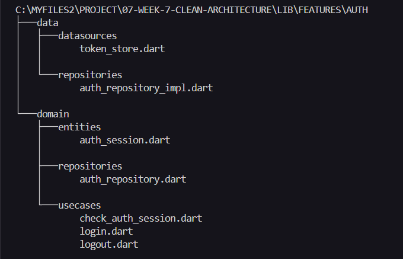

Melakukan pemeriksaan kode

Menjalankan dart format dan flutter analyze. Memperbaiki saran prefer_initializing_formals dengan menggunakan constructor AuthRepositoryImpl(this._tokenStore).

Berikut merupakan hasil pemeriksaan static analysis setelah perbaikan.

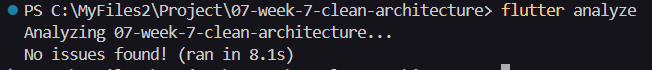

Memeriksa import pada domain menggunakan Select-String. Pencarian import package digunakan untuk memastikan domain tidak bergantung pada Flutter atau plugin.

Berikut merupakan hasil pemeriksaan import domain.

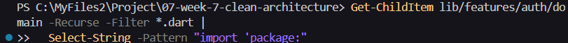

Pada tahap ini, domain dan data baru belum dihubungkan ke presentation. Aplikasi masih menggunakan provider dan repository lama. Penyusunan DI, penghubungan notifier ke use case, serta penghapusan file lama dilakukan pada Praktikum 3.

## Praktikum 3: Presentation, DI, dan Verifikasi

Menghubungkan domain dan data fitur auth ke presentation menggunakan Riverpod. Refactor dilakukan pada fitur autentikasi yang sudah tersedia di Campus Notify.

Membuat dependency injection dengan Riverpod

Membuat lib/features/auth/di/auth_providers.dart untuk menyusun dependency TokenStore, AuthRepositoryImpl, dan use case autentikasi.

Provider repository menggunakan kontrak AuthRepository, sedangkan implementasinya menggunakan AuthRepositoryImpl. Use case menerima kontrak repository sehingga implementasi dapat diganti dengan repository palsu saat pengujian.

| Provider | Fungsi |
| --- | --- |
| tokenStoreProvider | Menyediakan penyimpanan token. |
| authRepositoryProvider | Menyediakan implementasi melalui kontrak AuthRepository. |
| checkAuthSessionProvider | Menyediakan use case pemeriksaan sesi. |
| loginUseCaseProvider | Menyediakan use case login. |
| logoutUseCaseProvider | Menyediakan use case logout. |

Membuat lib/di/app_providers.dart untuk menyediakan API client dan PushService yang digunakan lintas halaman. DebugPage dan main.dart memperoleh PushService melalui provider.

Menghubungkan notifier ke use case

Membuat lib/features/auth/presentation/providers/auth_state_provider.dart untuk mengelola state autentikasi.

AuthNotifier memanggil CheckAuthSession, Login, dan Logout melalui provider. Pembacaan, penyimpanan, serta penghapusan token dilakukan oleh repository, sehingga notifier tidak mengakses TokenStore secara langsung.

Notifier menyediakan state loading, berhasil, dan gagal untuk ditampilkan oleh halaman. Pesan Failure diteruskan sebagai pesan kesalahan tanpa menampilkan exception penyimpanan mentah.

Memisahkan halaman dari pengelolaan data

Memindahkan halaman login dari lib/pages/login_page.dart ke lib/features/auth/presentation/pages/login_page.dart.

LoginPage membaca authStateProvider dan memanggil notifier ketika tombol Login ditekan. Validasi email dan panjang password berada pada use case Login, sedangkan penyimpanan sesi berada pada data layer.

Memperbarui import pada main.dart dan HomePage agar menggunakan provider autentikasi yang baru.

Mengubah DebugPage agar memperoleh PushService melalui pushServiceProvider. Pesan kegagalan subscribe dan unsubscribe ditampilkan menggunakan pesan ramah pengguna.

Merapikan file lama

Memindahkan API client dan pemetaan pesan kesalahan ke lib/core/network. API client menerima callback pengelolaan sesi yang dihubungkan melalui DI.

Menghapus provider, repository, penyimpanan token, dan halaman login lama setelah seluruh pemanggilan menggunakan struktur baru.

Berikut merupakan struktur folder sebelum dan sesudah setelah penghubungan presentation dan DI.

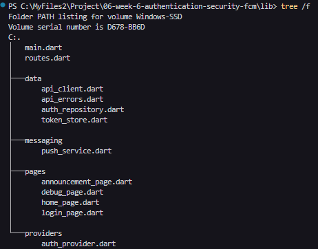

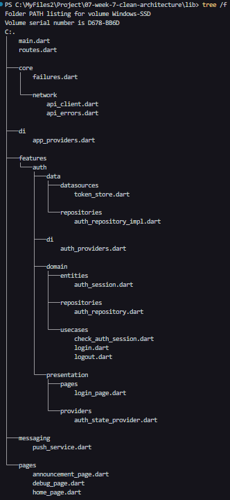

Melakukan verifikasi dependency rule

Menjalankan pencarian menggunakan Select-String pada PowerShell karena rg belum tersedia.

| Pemeriksaan | Lokasi pencarian | Hasil |
| --- | --- | --- |
| Akses data mentah pada presentation | lib/features/auth/presentation dan lib/pages | Tidak ditemukan kecocokan dengan pola pencarian. |
| Import package pada domain | lib/features/auth/domain | Tidak ditemukan. |
| Import package pada failure domain | lib/core/failures.dart | Tidak ditemukan. |

Pemeriksaan domain dilakukan pada lib/features/auth/domain dan lib/core/failures.dart. Folder lib/core/network merupakan infrastruktur jaringan yang menggunakan Dio sehingga tidak termasuk bagian domain murni.

Berikut merupakan hasil pemeriksaan presentation.

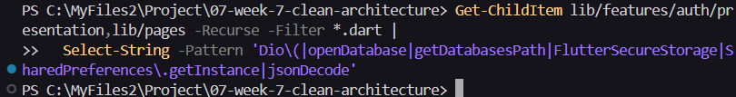

Berikut merupakan hasil pemeriksaan import domain dan failure.

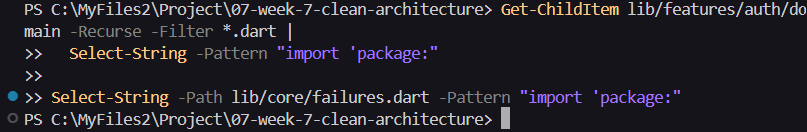

Tidak adanya kecocokan menunjukkan bahwa pola yang diperiksa tidak ditemukan. Pemeriksaan ini dilengkapi dengan peninjauan alur dependency pada kode.

Melakukan static analysis dan pengujian otomatis

Menjalankan flutter analyze setelah penghubungan seluruh file untuk memeriksa kesalahan dan peringatan kode.

Berikut merupakan hasil static analysis terbaru.

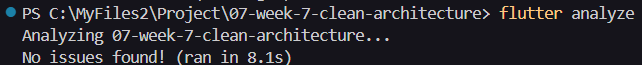

Menjalankan flutter test. Enam pengujian routeFromMessage berhasil dengan hasil All tests passed.

Pengujian mencakup rute pengumuman valid, rute Home, payload kosong, tipe route yang tidak sesuai, penolakan rute tidak valid, dan pemilihan tujuan ketika route berbeda dengan id.

Berikut merupakan hasil pengujian otomatis.

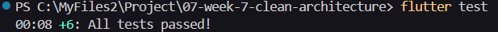

Pengujian yang tersedia saat ini memverifikasi parsing rute notifikasi. Pengujian use case auth menggunakan repository palsu belum ditambahkan.

Melakukan pengujian manual

Menjalankan aplikasi pada emulator Android dan mencoba alur fitur untuk membandingkan perilaku sebelum serta setelah refactor. Autentikasi masih menggunakan simulasi seperti pada Minggu 6.

| Fitur | Cara pengujian | Hasil yang diharapkan | Hasil aktual |
| --- | --- | --- | --- |
| Login gagal | Memasukkan email tanpa @ atau password kurang dari enam karakter. | Pesan kesalahan muncul dan tetap di halaman login. | Belum dicatat. |
| Login berhasil | Memasukkan mahasiswa@kampus.ac.id dan password 123456. | Halaman Home terbuka. | Belum dicatat. |
| Sesi login | Menutup dan membuka kembali aplikasi setelah login. | Sesi tersimpan dan halaman Home terbuka. | Belum dicatat. |
| Logout | Menekan tombol logout pada Home. | Kembali ke halaman login. | Belum dicatat. |
| Pengumuman | Menekan Buka Pengumuman. | Halaman pengumuman dengan ID 1 terbuka. | Belum dicatat. |
| Notifikasi | Mengirim dan mengeklik notifikasi pada foreground, background, dan terminated. | Notifikasi membuka tujuan sesuai payload. | Belum dicatat. |
| Topik | Menekan Subscribe dan Unsubscribe pada Debug FCM. | Operasi berhasil dan status topik berubah. | Belum dicatat. |

Membandingkan tampilan sebelum dan setelah refactor

Menggunakan project Minggu 6 sebagai kondisi sebelum refactor dan project Minggu 7 sebagai kondisi setelah refactor.

Berikut merupakan tampilan login sebelum dan setelah refactor.

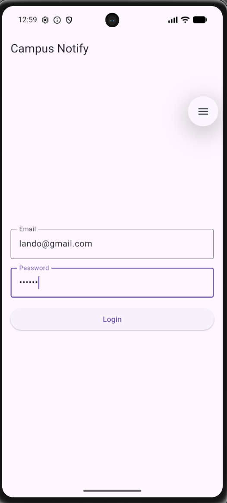

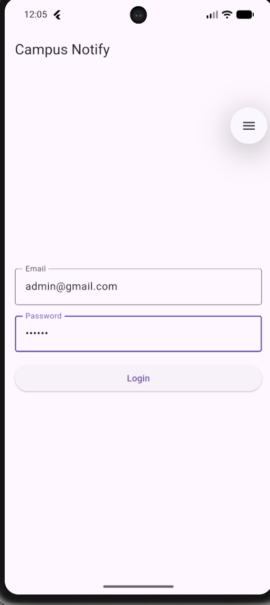

Berikut merupakan tampilan Home sebelum dan setelah refactor.

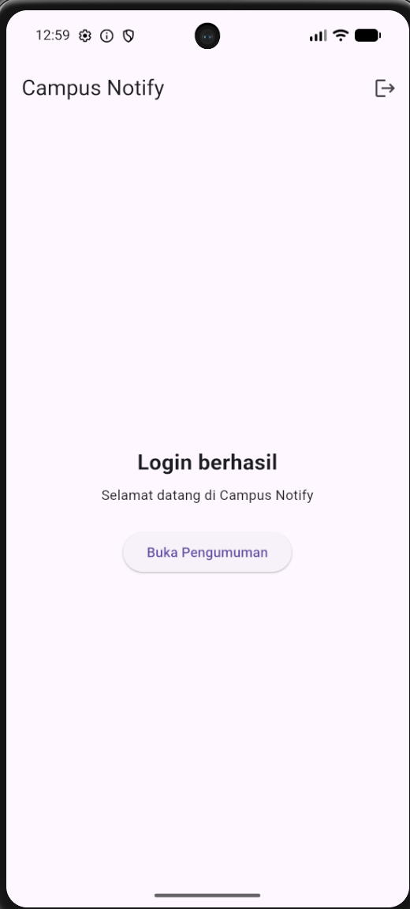

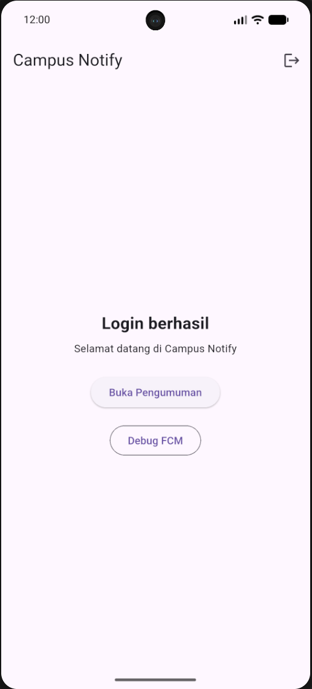

Dan berikut merupakan tampilan notifiksi pada state foreground.

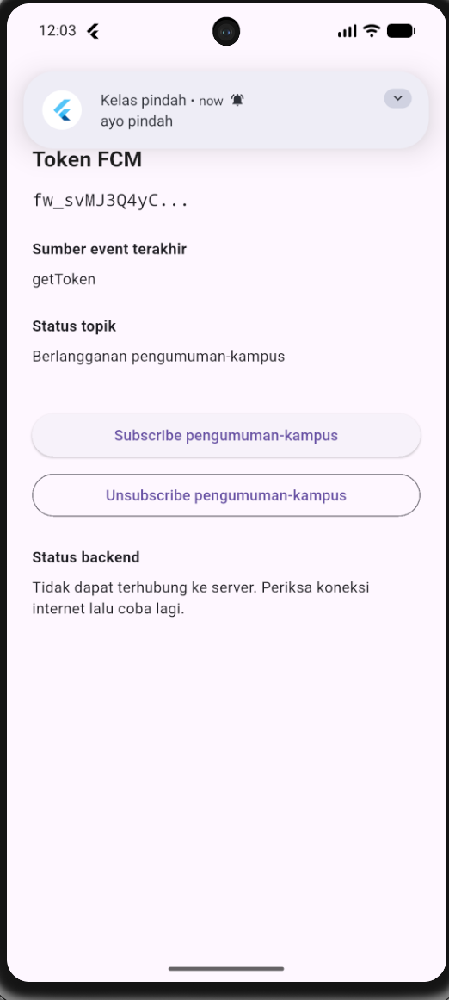

Berikut merupakan struktur folder sebelum refactor.


Perbandingan digunakan untuk memastikan tampilan dan perilaku aplikasi tetap sama setelah susunan kode dipisahkan menjadi domain, data, presentation, dan DI.

## AI Challenge

1. Agent yang dipakai: Copilot

2. Prompt yang digunakan:

        Project Flutter saya: campus_notify (auth + FCM + daftar pengumuman).
        Kondisi kini: folder lib/{data, providers, pages, messaging},
        repository tercampur dengan implementasi, widget memanggil Dio langsung.
        Tugas:
        1. Usulkan struktur feature-first Clean Architecture
        (presentation/domain/data) untuk fitur auth + announcements.
        2. Untuk tiap file lama, sebutkan tujuan barunya (pindah/pecah/hapus).
        3. Tandai bagian yang over-engineering bila diterapkan ke CRUD sederhana,
        dan kapan use case benar-benar dibutuhkan vs repository langsung.
        4. Tunjukkan wiring DI dengan Riverpod (tanpa package DI tambahan).
        Jelaskan trade-off setiap keputusan.

3. Output Awal AI:

        Read skill `analyzing-architecture`

        Saya akan memetakan struktur aktual terlebih dahulu agar usulan dan tabel pemetaan file lama tidak bersifat generik. Fokusnya pada `lib/`, entry point, dependency, serta pola repository/provider/widget yang sudah ada.

        Find files matching `07-week-7-clean-architecture/lib/**`

        Find files matching `07-week-7-clean-architecture/**/pubspec.yaml`

        Read , lines 1 to 180
        Completed with input: {
        "path": "C:\\MyFiles2\\Project\\07-week-7-clean-architecture\\lib\\main.dart",
        "view_range": [
            1,
            180
        ]
        }

        Read , lines 1 to 180
        Completed with input: {
        "path": "C:\\MyFiles2\\Project\\07-week-7-clean-architecture\\pubspec.yaml",
        "view_range": [
            1,
            180
        ]
        }

        Read , lines 1 to 220
        Completed with input: {
        "path": "C:\\MyFiles2\\Project\\07-week-7-clean-architecture\\lib\\features\\auth\\data\\repositories\\auth_repository_impl.dart",
        "view_range": [
            1,
            220
        ]
        }

        Read , lines 1 to 160
        Completed with input: {
        "path": "C:\\MyFiles2\\Project\\07-week-7-clean-architecture\\lib\\features\\auth\\domain\\repositories\\auth_repository.dart",
        "view_range": [
            1,
            160
        ]
        }

        Read , lines 1 to 200
        Completed with input: {
        "path": "C:\\MyFiles2\\Project\\07-week-7-clean-architecture\\lib\\features\\auth\\presentation\\providers\\auth_state_provider.dart",
        "view_range": [
            1,
            200
        ]
        }

        Read , lines 1 to 220
        Completed with input: {
        "path": "C:\\MyFiles2\\Project\\07-week-7-clean-architecture\\lib\\features\\auth\\di\\auth_providers.dart",
        "view_range": [
            1,
            220
        ]
        }

        Read , lines 1 to 220
        Completed with input: {
        "path": "C:\\MyFiles2\\Project\\07-week-7-clean-architecture\\lib\\di\\app_providers.dart",
        "view_range": [
            1,
            220
        ]
        }

        Read , lines 1 to 220
        Completed with input: {
        "path": "C:\\MyFiles2\\Project\\07-week-7-clean-architecture\\lib\\core\\network\\api_client.dart",
        "view_range": [
            1,
            220
        ]
        }

        Read , lines 1 to 180
        Completed with input: {
        "path": "C:\\MyFiles2\\Project\\07-week-7-clean-architecture\\lib\\core\\failures.dart",
        "view_range": [
            1,
            180
        ]
        }

        Read , lines 1 to 240
        Completed with input: {
        "path": "C:\\MyFiles2\\Project\\07-week-7-clean-architecture\\lib\\features\\auth\\presentation\\pages\\login_page.dart",
        "view_range": [
            1,
            240
        ]
        }

        Read , lines 1 to 260
        Completed with input: {
        "path": "C:\\MyFiles2\\Project\\07-week-7-clean-architecture\\lib\\pages\\home_page.dart",
        "view_range": [
            1,
            260
        ]
        }

        Read , lines 1 to 260
        Completed with input: {
        "path": "C:\\MyFiles2\\Project\\07-week-7-clean-architecture\\lib\\pages\\announcement_page.dart",
        "view_range": [
            1,
            260
        ]
        }

        Read , lines 1 to 260
        Completed with input: {
        "path": "C:\\MyFiles2\\Project\\07-week-7-clean-architecture\\lib\\pages\\debug_page.dart",
        "view_range": [
            1,
            260
        ]
        }

        Read , lines 1 to 320
        Completed with input: {
        "path": "C:\\MyFiles2\\Project\\07-week-7-clean-architecture\\lib\\messaging\\push_service.dart",
        "view_range": [
            1,
            320
        ]
        }

        Read , lines 1 to 160
        Completed with input: {
        "path": "C:\\MyFiles2\\Project\\07-week-7-clean-architecture\\lib\\routes.dart",
        "view_range": [
            1,
            160
        ]
        }

        Read , lines 1 to 180
        Completed with input: {
        "path": "C:\\MyFiles2\\Project\\07-week-7-clean-architecture\\lib\\features\\auth\\data\\datasources\\token_store.dart",
        "view_range": [
            1,
            180
        ]
        }

        Read , lines 1 to 120
        Completed with input: {
        "path": "C:\\MyFiles2\\Project\\07-week-7-clean-architecture\\lib\\features\\auth\\domain\\entities\\auth_session.dart",
        "view_range": [
            1,
            120
        ]
        }

        Read , lines 1 to 140
        Completed with input: {
        "path": "C:\\MyFiles2\\Project\\07-week-7-clean-architecture\\lib\\features\\auth\\domain\\usecases\\login.dart",
        "view_range": [
            1,
            140
        ]
        }

        Read , lines 1 to 120
        Completed with input: {
        "path": "C:\\MyFiles2\\Project\\07-week-7-clean-architecture\\lib\\features\\auth\\domain\\usecases\\logout.dart",
        "view_range": [
            1,
            120
        ]
        }

        Read , lines 1 to 120
        Completed with input: {
        "path": "C:\\MyFiles2\\Project\\07-week-7-clean-architecture\\lib\\features\\auth\\domain\\usecases\\check_auth_session.dart",
        "view_range": [
            1,
            120
        ]
        }

        ## 1. Struktur feature-first yang disarankan

        Kondisi saat ini sudah mulai menuju feature-first pada `auth`, tetapi masih bercampur dengan folder global seperti `pages/`, `messaging/`, dan `di/`.

        Struktur yang lebih konsisten:

        ```text
        lib/
        ├── app/
        │   ├── app.dart
        │   ├── router.dart
        │   └── routes.dart
        │
        ├── core/
        │   ├── errors/
        │   │   ├── failure.dart
        │   │   └── exception_mapper.dart
        │   ├── network/
        │   │   ├── api_client.dart
        │   │   └── api_errors.dart
        │   └── config/
        │       └── env.dart
        │
        ├── features/
        │   ├── auth/
        │   │   ├── data/
        │   │   │   ├── datasources/
        │   │   │   │   ├── auth_remote_data_source.dart
        │   │   │   │   └── token_local_data_source.dart
        │   │   │   ├── models/
        │   │   │   │   └── auth_session_model.dart
        │   │   │   └── repositories/
        │   │   │       └── auth_repository_impl.dart
        │   │   │
        │   │   ├── domain/
        │   │   │   ├── entities/
        │   │   │   │   └── auth_session.dart
        │   │   │   ├── repositories/
        │   │   │   │   └── auth_repository.dart
        │   │   │   └── usecases/
        │   │   │       ├── check_auth_session.dart
        │   │   │       ├── login.dart
        │   │   │       └── logout.dart
        │   │   │
        │   │   ├── presentation/
        │   │   │   ├── pages/
        │   │   │   │   └── login_page.dart
        │   │   │   └── providers/
        │   │   │       └── auth_controller.dart
        │   │   │
        │   │   └── di/
        │   │       └── auth_providers.dart
        │   │
        │   ├── announcements/
        │   │   ├── data/
        │   │   │   ├── datasources/
        │   │   │   │   └── announcements_remote_data_source.dart
        │   │   │   ├── models/
        │   │   │   │   └── announcement_model.dart
        │   │   │   └── repositories/
        │   │   │       └── announcements_repository_impl.dart
        │   │   │
        │   │   ├── domain/
        │   │   │   ├── entities/
        │   │   │   │   └── announcement.dart
        │   │   │   ├── repositories/
        │   │   │   │   └── announcements_repository.dart
        │   │   │   └── usecases/
        │   │   │       ├── get_announcements.dart
        │   │   │       └── get_announcement_detail.dart
        │   │   │
        │   │   ├── presentation/
        │   │   │   ├── pages/
        │   │   │   │   ├── announcements_page.dart
        │   │   │   │   └── announcement_detail_page.dart
        │   │   │   ├── providers/
        │   │   │   │   ├── announcements_provider.dart
        │   │   │   │   └── announcement_detail_provider.dart
        │   │   │   └── widgets/
        │   │   │       └── announcement_card.dart
        │   │   │
        │   │   └── di/
        │   │       └── announcements_providers.dart
        │   │
        │   └── notifications/
        │       ├── data/
        │       │   └── fcm_service.dart
        │       ├── presentation/
        │       │   └── debug_page.dart
        │       └── di/
        │           └── notification_providers.dart
        │
        └── main.dart
        ```

        ### Batas tanggung jawab

        #### `presentation`

        Berisi:

        - Page dan widget Flutter.
        - `AsyncNotifier`, `Notifier`, atau provider Riverpod.
        - State loading, success, error.
        - Navigasi UI.

        Tidak boleh:

        - Memanggil `Dio` langsung.
        - Membaca `FlutterSecureStorage` langsung.
        - Mengetahui format JSON API.

        #### `domain`

        Berisi:

        - Entity murni Dart.
        - Interface repository.
        - Use case jika memang memberi nilai.
        - Aturan bisnis yang tidak bergantung pada Flutter, Dio, Firebase, atau storage.

        Tidak boleh mengimpor:

        ```dart
        package:flutter
        package:dio
        package:firebase_*
        package:flutter_secure_storage
        ```

        #### `data`

        Berisi:

        - Implementasi repository.
        - Data source remote/local.
        - Model DTO dan parsing JSON.
        - Adaptasi error Dio/API ke `Failure`.

        Dependency flow:

        ```text
        presentation -> domain
        data -> domain
        app/di -> presentation + data + domain
        domain -X-> data
        ```

        ---

        ## 2. Pemetaan file lama

        Berikut tujuan baru untuk setiap file yang saat ini ada.

        ### Entry point dan app-level

        | File lama | Tujuan baru |
        |---|---|
        | `lib/main.dart` | Tetap sebagai bootstrap minimal: `Firebase.initializeApp`, `ProviderScope`, dan `runApp`. Logic router dan messaging sebaiknya dipindahkan ke `app/app.dart` atau `app/router.dart`. |
        | `lib/routes.dart` | Pindah ke `lib/app/routes.dart`. Fungsi `routeFromMessage` dapat dipisah menjadi `notifications/data/notification_route_parser.dart` karena parsing payload FCM bukan tanggung jawab router. |
        | `lib/di/app_providers.dart` | Pecah menjadi provider berdasarkan feature: `core/di/network_providers.dart`, `features/auth/di/auth_providers.dart`, dan `features/notifications/di/notification_providers.dart`. Folder `di/` global dapat dihapus jika tidak lagi diperlukan. |

        ### Auth

        | File lama | Tujuan baru |
        |---|---|
        | `features/auth/domain/entities/auth_session.dart` | Pertahankan sebagai entity domain. Nama file boleh tetap. |
        | `features/auth/domain/repositories/auth_repository.dart` | Pertahankan sebagai kontrak domain. Sebaiknya hasil operasi memakai tipe result/failure yang konsisten, bukan banyak record nullable jika proyek membesar. |
        | `features/auth/domain/usecases/login.dart` | Pertahankan bila validasi login dianggap aturan bisnis. Jika hanya validasi form sederhana, pindahkan validasi ke presentation/form controller. |
        | `features/auth/domain/usecases/logout.dart` | Bisa dipertahankan, tetapi untuk logout satu langkah yang hanya meneruskan repository, ini kandidat dihapus. Controller dapat langsung memanggil repository. |
        | `features/auth/domain/usecases/check_auth_session.dart` | Bisa dipertahankan karena digunakan sebagai operasi startup/auth guard. Namun tidak wajib jika hanya meneruskan `repository.checkSession()`. |
        | `features/auth/data/repositories/auth_repository_impl.dart` | Pertahankan. Pecah tanggung jawab autentikasi remote dan penyimpanan token bila API nyata sudah tersedia. Saat ini file ini masih melakukan simulasi login dan token persistence sekaligus. |
        | `features/auth/data/datasources/token_store.dart` | Rename menjadi `token_local_data_source.dart`. `TokenStore` sudah tepat secara konsep sebagai data source lokal. |
        | `features/auth/di/auth_providers.dart` | Pertahankan sebagai wiring feature auth. Tambahkan provider remote data source jika login sudah menggunakan API. |
        | `features/auth/presentation/providers/auth_state_provider.dart` | Rename menjadi `auth_controller.dart` atau tetap sebagai provider. Tanggung jawabnya mengelola state autentikasi, bukan membuat aturan bisnis. |
        | `features/auth/presentation/pages/login_page.dart` | Pertahankan di lokasi sekarang. Sebaiknya controller tidak dinamai `login()` tanpa konteks; gunakan `ref.read(authControllerProvider.notifier).login(...)`. |

        ### Announcements

        | File lama | Tujuan baru |
        |---|---|
        | `lib/pages/home_page.dart` | Pindah ke `features/announcements/presentation/pages/home_page.dart` jika halaman tersebut memang entry point fitur pengumuman. Jika hanya shell aplikasi, pindah ke `app/presentation/home_page.dart`. |
        | `lib/pages/announcement_page.dart` | Pindah dan rename menjadi `features/announcements/presentation/pages/announcement_detail_page.dart`. Nantinya page membaca `announcementDetailProvider(id)`, bukan hanya menampilkan ID. |
        | Belum ada file announcement data/domain | Tambahkan entity `Announcement`, repository contract, remote data source, model, repository implementation, dan provider. |
        | Widget pengumuman yang nantinya berulang | Letakkan di `features/announcements/presentation/widgets/`, misalnya `announcement_card.dart`. |

        ### Messaging/FCM

        | File lama | Tujuan baru |
        |---|---|
        | `lib/messaging/push_service.dart` | Pindah ke `features/notifications/data/fcm_service.dart` atau `features/notifications/data/datasources/fcm_data_source.dart`. FCM dan local notification adalah detail data/platform, bukan domain pengumuman. |
        | Global `ValueNotifier` FCM di `push_service.dart` | Ganti dengan state provider Riverpod, misalnya `notificationDebugProvider` atau `notificationControllerProvider`. Global mutable state sulit diuji dan tidak mengikuti lifecycle Riverpod. |
        | `PushService.api` | Jangan biarkan service FCM mengetahui `Dio` secara umum. Buat `device_registration_repository` atau `device_remote_data_source` khusus endpoint `/devices`. |
        | `routeFromMessage` | Pindahkan ke parser khusus notifikasi atau app navigation mapper. |
        | `lib/pages/debug_page.dart` | Pindah ke `features/notifications/presentation/pages/notification_debug_page.dart`. Page membaca provider debug notification, bukan global `ValueNotifier`. |

        ### Core

        | File lama | Tujuan baru |
        |---|---|
        | `lib/core/failures.dart` | Pindah ke `core/errors/failure.dart`. Pertahankan `AuthFailure`, `NetworkFailure`, dan `LocalFailure` jika memang dipakai lintas fitur. |
        | `lib/core/network/api_client.dart` | Pertahankan di `core/network/api_client.dart`. Interceptor token/refresh berada di sini karena bersifat infrastruktur bersama. |
        | `lib/core/network/api_errors.dart` | Pertahankan di `core/network/` atau gabungkan sebagai `exception_mapper.dart`. Mapping error Dio ke pesan UI sebaiknya dilakukan di satu tempat. |

        ---

        ## 3. Use case versus repository langsung

        ### Use case benar-benar berguna ketika

        Gunakan use case jika operasi:

        1. Dipakai oleh lebih dari satu presentation surface.
        2. Memiliki aturan bisnis atau urutan proses.
        3. Menggabungkan beberapa repository atau data source.
        4. Memerlukan authorization/business policy.
        5. Perlu diuji terpisah dari Riverpod dan Flutter.
        6. Memiliki nama bisnis yang bermakna.

        Contoh yang layak memakai use case:

        ```dart
        class Login {
        const Login(this._repository);

        final AuthRepository _repository;

        Future<Result<AuthSession>> call({
            required String email,
            required String password,
        }) {
            if (!email.contains('@')) {
            return Future.value(
                const FailureResult(AuthFailure('Email tidak valid')),
            );
            }

            return _repository.login(
            email: email,
            password: password,
            );
        }
        }
        ```

        Atau proses yang lebih kompleks:

        ```text
        login
        -> request API
        -> simpan access token
        -> simpan refresh token
        -> register FCM token
        -> update auth state
        ```

        Proses seperti ini cukup layak menjadi `LoginUseCase`.

        ### Repository langsung sudah cukup ketika

        Untuk CRUD sederhana, use case dapat menjadi lapisan forwarding yang tidak memberi nilai:

        ```dart
        class GetAnnouncements {
        GetAnnouncements(this.repository);

        final AnnouncementsRepository repository;

        Future<List<Announcement>> call() {
            return repository.getAnnouncements();
        }
        }
        ```

        Jika hanya seperti itu, provider boleh langsung memakai repository:

        ```dart
        final announcementsProvider =
            FutureProvider.autoDispose<List<Announcement>>((ref) {
        return ref.watch(announcementsRepositoryProvider).getAnnouncements();
        });
        ```

        ### Rekomendasi praktis untuk proyek ini

        | Operasi | Rekomendasi |
        |---|---|
        | Login | Gunakan use case karena ada validasi dan kemungkinan token/session side effect. |
        | Check session | Use case opsional. Masih masuk akal untuk auth guard startup. |
        | Logout | Repository langsung cukup pada ukuran proyek saat ini. |
        | Refresh token | Letakkan di repository/auth session service karena dipanggil oleh interceptor. Tidak perlu use case UI khusus. |
        | Get daftar pengumuman | Repository langsung cukup jika hanya satu endpoint sederhana. |
        | Get detail pengumuman | Repository langsung cukup jika hanya `GET /announcements/:id`. |
        | Mark as read/favorite/filter kompleks | Gunakan use case jika mulai ada aturan dan beberapa operasi. |
        | Register device FCM | Use case atau service terpisah jika melibatkan token lokal, user session, dan API. |

        ### Yang berpotensi over-engineering

        Tandanya:

        - Satu file use case untuk setiap method repository tanpa aturan tambahan.
        - `AnnouncementModel`, `AnnouncementEntity`, dan `AnnouncementDto` dibuat tiga kelas untuk object CRUD yang identik.
        - Repository interface hanya dibuat agar “sesuai Clean Architecture”, tetapi tidak ada kebutuhan mock/test atau pergantian sumber data.
        - Factory, service locator, atau DI container tambahan hanya untuk membuat tiga provider.
        - Mapper terpisah untuk object yang hanya memiliki dua field dan tidak punya perubahan bentuk.
        - State class, event class, command class, dan result class dibuat sekaligus untuk satu halaman sederhana.
        - FCM dipisah menjadi terlalu banyak abstraction layer padahal hanya ada register token dan subscribe topic.

        Untuk aplikasi kampus sederhana, target yang seimbang adalah:

        ```text
        Page
        -> Riverpod provider/controller
            -> Repository interface
            -> Repository implementation
                -> Dio / Firebase / Secure Storage
        ```

        Tambahkan use case hanya ketika ada aturan bisnis yang nyata.

        ---

        ## 4. Wiring DI dengan Riverpod tanpa package tambahan

        Riverpod sudah dapat berfungsi sebagai composition root.

        ### Provider infrastruktur bersama

        Contoh `core/di/network_providers.dart`:

        ```dart
        import 'dart:async';

        import 'package:dio/dio.dart';
        import 'package:flutter_riverpod/flutter_riverpod.dart';

        import '../../features/auth/di/auth_providers.dart';
        import '../network/api_client.dart';

        const apiBaseUrl = String.fromEnvironment(
        'API_BASE_URL',
        defaultValue: 'https://example-campus-api.test',
        );

        final apiClientProvider = Provider<Dio>((ref) {
        final tokenStore = ref.watch(tokenStoreProvider);
        final authRepository = ref.watch(authRepositoryProvider);

        final dio = buildApiClient(
            baseUrl: apiBaseUrl,
            readAccess: tokenStore.readAccess,
            readRefresh: tokenStore.readRefresh,
            refreshAccess: (refreshToken) async {
            final result = await authRepository.refresh(refreshToken);
            return result.failure == null ? result.access : null;
            },
        );

        ref.onDispose(() {
            unawaited(dio.close(force: true));
        });

        return dio;
        });
        ```

        ### Provider auth

        `features/auth/di/auth_providers.dart`:

        ```dart
        import 'package:flutter_riverpod/flutter_riverpod.dart';
        import 'package:flutter_secure_storage/flutter_secure_storage.dart';

        import '../data/datasources/token_local_data_source.dart';
        import '../data/repositories/auth_repository_impl.dart';
        import '../domain/repositories/auth_repository.dart';
        import '../domain/usecases/check_auth_session.dart';
        import '../domain/usecases/login.dart';

        final secureStorageProvider = Provider<FlutterSecureStorage>((ref) {
        return const FlutterSecureStorage();
        });

        final tokenStoreProvider = Provider<TokenLocalDataSource>((ref) {
        return TokenLocalDataSource(
            storage: ref.watch(secureStorageProvider),
        );
        });

        final authRepositoryProvider = Provider<AuthRepository>((ref) {
        return AuthRepositoryImpl(
            tokenStore: ref.watch(tokenStoreProvider),
            // api: ref.watch(apiClientProvider), jika login memakai API
        );
        });

        final loginUseCaseProvider = Provider<Login>((ref) {
        return Login(ref.watch(authRepositoryProvider));
        });

        final checkAuthSessionProvider = Provider<CheckAuthSession>((ref) {
        return CheckAuthSession(ref.watch(authRepositoryProvider));
        });
        ```

        Jika `apiClientProvider` bergantung pada `authRepositoryProvider`, jangan membuat dependency cycle seperti ini:

        ```text
        apiClient -> authRepository -> apiClient
        ```

        Solusi yang lebih aman:

        1. Pisahkan operasi refresh token ke `AuthSessionDataSource`.
        2. Atau buat `Dio` dasar tanpa interceptor.
        3. Buat authenticated client setelah dependency auth siap.
        4. Atau repository auth menggunakan client publik yang tidak bergantung pada interceptor refresh.

        Untuk proyek kecil, opsi paling sederhana:

        ```text
        plainDioProvider
        -> authRepositoryProvider

        authenticatedDioProvider
        -> tokenStoreProvider + authSessionRefreshProvider
        -> announcementRepositoryProvider
        ```

        Jangan membuat `apiClientProvider` bergantung penuh pada repository yang juga memakai client yang sama.

        ### Provider announcements

        Jika CRUD masih sederhana:

        ```dart
        final announcementsRemoteDataSourceProvider =
            Provider<AnnouncementsRemoteDataSource>((ref) {
        return AnnouncementsRemoteDataSource(
            api: ref.watch(apiClientProvider),
        );
        });

        final announcementsRepositoryProvider =
            Provider<AnnouncementsRepository>((ref) {
        return AnnouncementsRepositoryImpl(
            ref.watch(announcementsRemoteDataSourceProvider),
        );
        });

        final announcementsProvider =
            FutureProvider.autoDispose<List<Announcement>>((ref) {
        return ref.watch(announcementsRepositoryProvider).getAnnouncements();
        });

        final announcementDetailProvider = FutureProvider.autoDispose
            .family<Announcement, String>((ref, id) {
        return ref.watch(announcementsRepositoryProvider).getAnnouncement(id);
        });
        ```

        Untuk operasi mutasi, gunakan `AsyncNotifier`:

        ```dart
        final announcementsControllerProvider =
            AsyncNotifierProvider<AnnouncementsController, void>(
        AnnouncementsController.new,
        );

        class AnnouncementsController extends AsyncNotifier<void> {
        @override
        Future<void> build() async {}

        Future<void> markAsRead(String id) async {
            state = const AsyncLoading();

            try {
            await ref.read(announcementsRepositoryProvider).markAsRead(id);
            state = const AsyncData(null);
            } catch (error, stackTrace) {
            state = AsyncError(error, stackTrace);
            }
        }
        }
        ```

        ### Provider FCM

        ```dart
        final fcmServiceProvider = Provider<FcmService>((ref) {
        final service = FcmService(
            messaging: FirebaseMessaging.instance,
            localNotifications: FlutterLocalNotificationsPlugin(),
            deviceRepository: ref.watch(deviceRepositoryProvider),
        );

        ref.onDispose(service.dispose);

        return service;
        });
        ```

        Status debug sebaiknya menjadi state Riverpod:

        ```dart
        class NotificationDebugState {
        const NotificationDebugState({
            this.tokenPreview = 'Belum tersedia',
            this.tokenSource = 'Belum ada event token',
            this.topicStatus = 'Belum berlangganan',
            this.backendStatus = 'Belum dikirim',
        });

        final String tokenPreview;
        final String tokenSource;
        final String topicStatus;
        final String backendStatus;
        }

        final notificationDebugProvider =
            NotifierProvider<NotificationDebugNotifier, NotificationDebugState>(
        NotificationDebugNotifier.new,
        );
        ```

        Dengan begitu, `DebugPage` tidak perlu mengonsumsi global:

        ```dart
        final fcmTokenPreview = ValueNotifier<String>(...);
        ```

        ### App wiring

        `main.dart` sebaiknya menjadi minimal:

        ```dart
        Future<void> main() async {
        WidgetsFlutterBinding.ensureInitialized();
        await Firebase.initializeApp();

        registerBackgroundHandler();

        runApp(
            const ProviderScope(
            child: CampusNotifyApp(),
            ),
        );
        }
        ```

        Kemudian router dan listener dipindah ke `app/app.dart`:

        ```dart
        class CampusNotifyApp extends ConsumerWidget {
        const CampusNotifyApp({super.key});

        @override
        Widget build(BuildContext context, WidgetRef ref) {
            final router = ref.watch(routerProvider);

            return MaterialApp.router(
            title: 'Campus Notify',
            debugShowCheckedModeBanner: false,
            routerConfig: router,
            );
        }
        }
        ```

        ---

        ## 5. Trade-off keputusan arsitektur

        | Keputusan | Keuntungan | Biaya/trade-off |
        |---|---|---|
        | Feature-first | Semua code auth atau announcements mudah ditemukan dan perubahan lebih terisolasi. | Ada lebih banyak folder dan beberapa file dengan nama serupa antar-feature. |
        | Domain interface repository | UI tidak terikat Dio/Firebase dan mudah di-test dengan fake repository. | Menambah interface dan implementasi. Bisa berlebihan untuk prototype kecil. |
        | Use case selektif | Aturan bisnis punya tempat yang jelas tanpa membuat semua CRUD verbose. | Perlu keputusan per operasi, bukan aturan mekanis satu use case per method. |
        | Riverpod sebagai DI | Tidak menambah package, lifecycle dan disposal terkelola, mudah override saat test. | Dependency wiring tersebar di provider file jika tidak dibuat konvensional. |
        | `Dio` di data/core saja | Widget tidak tergantung HTTP detail. | Perlu membuat data source/repository wrapper. |
        | FCM sebagai feature notifications | Platform code tidak mencemari auth/announcements. | FCM route handling perlu koordinasi dengan app router. |
        | Entity dan model terpisah | API DTO dapat berubah tanpa memengaruhi domain/UI. | Untuk object kecil, mapping dapat terasa repetitif. |
        | Menghapus global `ValueNotifier` | State lebih mudah dilacak, diuji, dan di-dispose. | Perlu membuat state/provider tambahan untuk halaman debug. |

        ## Rekomendasi akhir

        Untuk ukuran `campus_notify` saat ini, saya menyarankan **Clean Architecture pragmatis**:

        ```text
        Feature
        ├── presentation
        ├── domain
        └── data
        ```

        Tetapi jangan memaksakan semua pola:

        - Auth: gunakan repository dan use case untuk login.
        - Announcements: repository langsung dari provider sudah cukup untuk read-only CRUD sederhana.
        - Notifications: jadikan feature/platform service terpisah.
        - Riverpod: gunakan sebagai satu-satunya DI container.
        - Pindahkan `Dio` keluar dari widget.
        - Pindahkan global `ValueNotifier` FCM ke Riverpod secara bertahap.
        - Jangan membuat abstraction baru sebelum ada kebutuhan test, reuse, atau aturan bisnis nyata.

4. AI Verification Checklist:

1. Apakah interface repository tinggal di domain dan implementasi di data? (tolak bila AI menaruh keduanya di satu folder).

Jawaban:
Ya. Usulan AI memisahkan kontrak repository pada domain dan implementasinya pada data. Pemisahan ini sudah diterapkan pada fitur auth.

Kontrak AuthRepository berada pada lib/features/auth/domain/repositories/auth_repository.dart, sedangkan AuthRepositoryImpl berada pada lib/features/auth/data/repositories/auth_repository_impl.dart.

Keputusan ini diterima karena domain tidak perlu mengetahui cara penyimpanan token atau implementasi autentikasi.

2. Apakah domain bebas import Flutter/Dio/SQLite/Firebase? Periksa dengan grep, bukan dengan membaca sekilas.

Jawaban:
Ya, berdasarkan pencarian menggunakan Select-String pada lib/features/auth/domain dan lib/core/failures.dart, tidak ditemukan import package.

Folder lib/core/network tidak termasuk domain murni karena menyediakan infrastruktur jaringan yang menggunakan Dio. Hasil pencarian ini berlaku untuk kode project yang diperiksa, bukan seluruh contoh kode usulan AI.

3. Apakah AI membuat use case untuk tiap CRUD satu-baris? (itu over-engineering: cukup repository langsung ke notifier, dengan alasan tertulis).

Jawaban:
Pada struktur awal, AI mengusulkan get_announcements.dart dan get_announcement_detail.dart. Namun, pada penjelasan berikutnya AI menyatakan bahwa operasi pengambilan data sederhana cukup dipanggil melalui repository dari provider atau notifier.

Usulan struktur dan penjelasan tersebut belum sepenuhnya konsisten. Saya memilih tidak menambahkan use case pengumuman yang hanya meneruskan satu operasi repository.

Use case Login dipertahankan karena memiliki validasi email dan panjang password sebelum memanggil repository.

CheckAuthSession dan Logout masih dipertahankan untuk konsistensi alur pembelajaran. Keduanya saat ini hanya meneruskan operasi repository, sehingga bersifat opsional dan menambah file tanpa aturan bisnis tambahan. Pada aplikasi sederhana, notifier dapat langsung memanggil kontrak repository untuk kedua operasi tersebut.

4. Apakah entity bebas mapping (toMap/fromMap/toJson hanya di model)?

Jawaban:
Entity AuthSession yang digunakan pada project hanya berisi constructor, access token, dan refresh token. Entity tidak memiliki toMap, fromMap, atau toJson.

AI mengusulkan AuthSessionModel untuk mapping data. Usulan tersebut ditunda karena autentikasi masih menggunakan simulasi dan belum menerima respons JSON dari API.

Jika integrasi API diterapkan, mapping respons akan ditempatkan pada model di data layer. Entity domain tetap bebas dari format penyimpanan dan respons API.

5. Apakah wiring DI terpusat di provider dan widget tidak new Repository() sendiri?

Jawaban:
Ya. Wiring fitur auth berada pada lib/features/auth/di/auth_providers.dart. Penyusunan API client dan PushService berada pada lib/di/app_providers.dart.

AuthNotifier memperoleh use case melalui provider. LoginPage dan HomePage menggunakan provider state autentikasi, sedangkan DebugPage memperoleh PushService melalui pushServiceProvider.

Pembuatan instance repository dilakukan pada provider DI, bukan di dalam widget. Riverpod digunakan tanpa package DI tambahan.

Contoh wiring dari AI tidak disalin langsung karena belum sesuai dengan project. Constructor AuthRepositoryImpl pada project menggunakan parameter posisi, sedangkan contoh AI menggunakan parameter bernama tokenStore. Contoh unawaited(dio.close(force: true)) juga perlu dikoreksi karena Dio.close mengembalikan void.

6. Keputusan final dan alasan teknis Anda, boleh berbeda dari saran AI selama berargumen.

Jawaban:
Saya mempertahankan refactor yang berfokus pada fitur auth yang sudah tersedia. Usulan AI digunakan sebagai bahan evaluasi, sehingga tidak seluruh perubahan folder dan penambahan abstraksi diterapkan.

| Usulan AI | Keputusan final | Alasan teknis |
| --- | --- | --- |
| Memisahkan kontrak repository dan implementasi | Diterima; sudah diterapkan pada auth. | Memisahkan aturan domain dari detail penyimpanan dan autentikasi. |
| Domain bebas framework dan plugin | Diterima. | Memungkinkan aturan bisnis diuji tanpa Firebase atau secure storage. |
| Menggunakan use case Login | Diterima. | Memiliki validasi sebelum memanggil repository. |
| Menghapus use case Logout dan CheckAuthSession | Tidak diterapkan saat ini. | Dipertahankan untuk konsistensi pembelajaran, dengan pengakuan bahwa keduanya masih berupa forwarding dan bersifat opsional. |
| Membuat model sesi autentikasi | Ditunda. | Belum ada mapping respons API pada autentikasi simulasi. |
| Menambahkan daftar pengumuman, API, model, dan repository baru | Tidak diterapkan pada praktikum ini. | Memperluas fitur, sedangkan tugas berfokus pada refactor kode yang sudah berjalan. |
| Menyusun dependency melalui Riverpod | Diterima; sudah diterapkan. | Dependency disediakan melalui provider dan dapat diganti saat pengujian. |
| Mengganti seluruh ValueNotifier FCM dengan state Riverpod | Ditunda. | Membutuhkan perubahan pengelolaan state messaging di luar fokus refactor auth. |
| Memindahkan dan mengganti nama seluruh file app/core | Tidak diterapkan seluruhnya. | Struktur saat ini sudah memisahkan tanggung jawab utama fitur auth. |
| Menggunakan contoh Result dan FailureResult | Tidak diterapkan. | Tipe tersebut belum didefinisikan; project sudah menggunakan record Dart dan Failure. |

Prompt awal menyebut widget memanggil Dio langsung. Namun, audit project sebelumnya tidak menemukan kecocokan pola tersebut pada halaman. Karena itu, pernyataan dalam prompt tidak digunakan sebagai bukti pelanggaran.

Arah dependensi yang dipertahankan adalah presentation menuju domain dan data menuju domain. DI menghubungkan kontrak domain dengan implementasi data. Domain tidak mengimpor presentation atau data.

Trade-off keputusan ini adalah jumlah file bertambah untuk memisahkan tanggung jawab auth, tetapi penambahan model, data source remote, dan use case pengumuman ditunda sampai terdapat kebutuhan nyata.

Berikut merupakan hasil ketiga grep

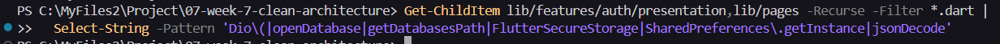

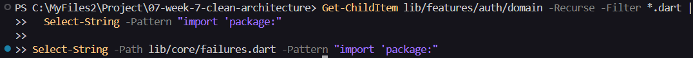

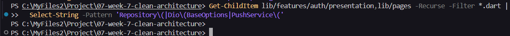

