# 08-week-8-mid-project-review

## Tujuan

1. Menjelaskan Git Flow dan strategi branching (main, develop, feature/*, fix/*).
2. Menulis commit dan Pull Request yang berkualitas dan mudah direview.
3. Melakukan peer code review yang konstruktif dengan checklist terstruktur.
4. Menjalankan static analysis dan formatter (flutter analyze, dart format) hingga bersih.
5. Menilai kesiapan project tengah semester dan menindaklanjuti hasil review.
6. Memverifikasi saran review dari AI sebelum diterapkan.

## Praktikum 1:

1. Menjalankan perintah di repository project Minggu 5-7

Berikut merupakan tampilan ketika menjalankan perintah di repository project Minggu 5-7.

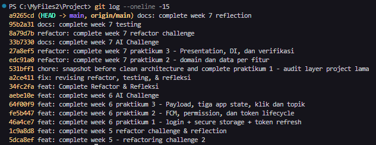

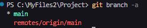

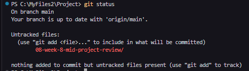

2. Membuat branch kerja yang benar

Menjalankan perintah git sesuai pada modul untuk membuat branch yang benar.

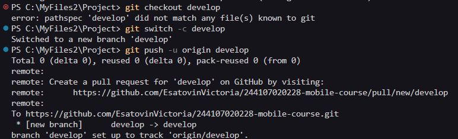

Membuat branch feature untuk menambahkan branch kerja yang benar.

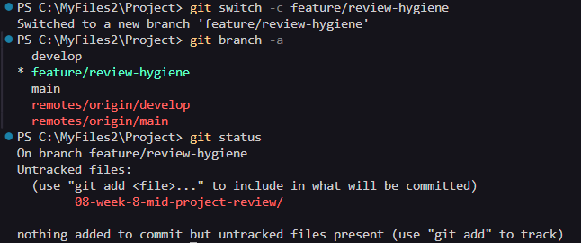

3. Memperbaiki satu commit buruk (simulasi)

## Praktikum 2: PR dan peer review

1. Buka PR kecil

Masalah yang diperbaiki adalah validasi Login yang masih menerima email tidak lengkap karena hanya memeriksa keberadaan karakter @.

- Issue: Login validation accepts incomplete email addresses #1
- Branch kerja: fix/1-auth-email-validation
- Target PR: develop
- Pull Request: fix(auth): reject invalid email addresses and add tests #2

Perbaikan dilakukan pada use case Login dengan menambahkan validasi format dasar email. Unit test menggunakan fake repository untuk memeriksa penolakan input tidak valid, penerusan input valid, dan penerusan failure dari repository.

Hasil pemeriksaan:

- dart format: kedua file sudah diformat.
- flutter test test/login_test.dart: 14 test lulus.
- flutter analyze: No issues found.
- flutter test: seluruh 27 test lulus.
- git diff --check: tidak ditemukan masalah whitespace.

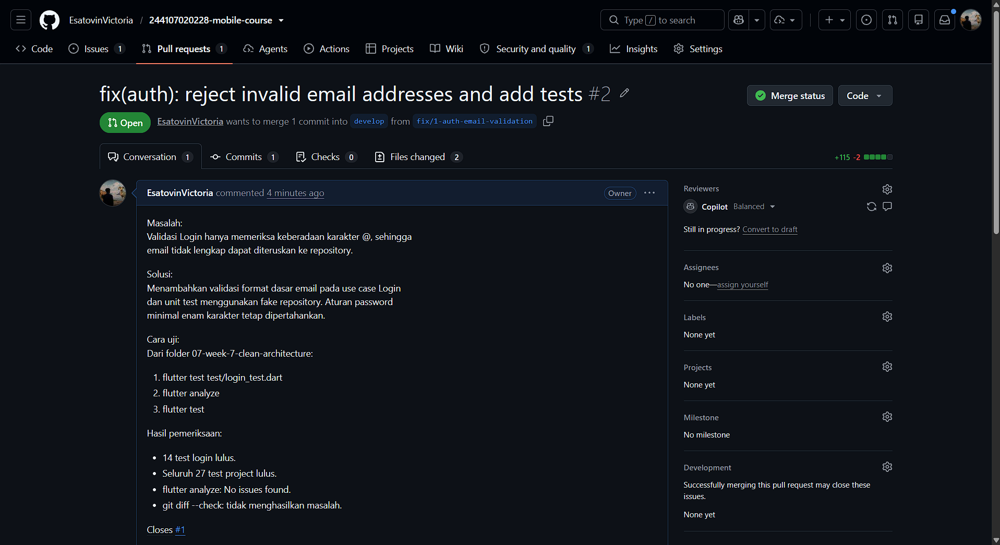

2. Review

Review dilakukan secara mandiri melalui self-review pada PR #2.

- Kebenaran input: email tidak valid atau password kurang dari enam karakter menghasilkan AuthFailure tanpa memanggil repository. Test memeriksa session null, jenis failure, dan jumlah pemanggilan repository.
- Kebenaran hasil: input valid diteruskan ke repository, sedangkan session dan failure dari repository dikembalikan kepada pemanggil. Test memeriksa argumen, hasil, dan jumlah pemanggilan.
- Arsitektur: Login bergantung pada kontrak AuthRepository. Tidak ditemukan penambahan ketergantungan pada implementasi data, Firebase, atau widget.
- Test: belum terdapat kasus password lebih dari enam karakter. Saran review adalah menambahkan test password tujuh karakter untuk memastikan input tetap diterima.
- Keterbacaan: regex ditulis langsung dalam Login.call. Saran review adalah memberikan komentar singkat mengenai aturan format dasar yang diperiksa.

Keputusan self-review: Approve.

Perubahan memenuhi kriteria issue #1 dan seluruh pengujian lulus. Saran tambahan dinilai tidak menghalangi merge.

3. Komentar yang konstruktif

Komentar review menggunakan pola observasi, dampak, dan usulan konkret.

Observasi: panjang password yang diuji adalah 0, 5, dan 6 karakter.

Dampak: penerimaan password lebih dari enam karakter belum diuji.

Usulan: tambahkan test password tujuh karakter dengan email valid, kemudian pastikan repository dipanggil satu kali.

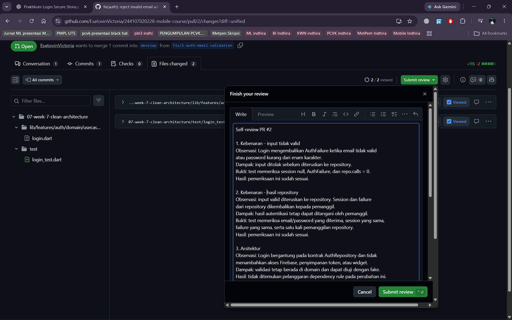

4. Tindak lanjut dan merge

PR #2 digabungkan ke develop menggunakan merge commit. PR hanya memiliki satu commit sehingga tidak diperlukan squash untuk merapikan commit perantara.

Saran tambahan pada self-review tidak diterapkan karena dinilai tidak menghalangi merge.

Issue #1 ditutup secara manual sebagai Completed setelah merge. Penutupan otomatis melalui Closes #1 tidak terjadi karena target PR adalah develop, sedangkan default branch repository masih main.

Branch remote dan lokal fix/1-auth-email-validation sudah dihapus. Branch develop lokal sudah diperbarui dan sinkron dengan origin/develop.

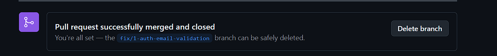

## Praktikum 3: Static analysis dan mid review

1. Bersihkan dengan mesin

Pemeriksaan dijalankan pada project 07-week-7-clean-architecture.

- flutter analyze: No issues found.
- dart format --set-exit-if-changed .: 31 file diperiksa, 0 changed.
- flutter test: seluruh 27 test lulus.

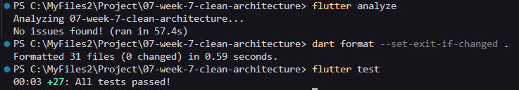

2. Aktifkan penolakan otomatis (CI)

Workflow ci dibuat pada .github/workflows/ci.yml dan dijalankan saat pull_request. Job verify menggunakan ubuntu-latest, menyiapkan Flutter 3.47.1 pada channel stable, lalu menjalankan flutter analyze dan flutter test dari folder 07-week-7-clean-architecture.

Pemeriksaan CI pada PR #3 selesai dengan hasil passed.

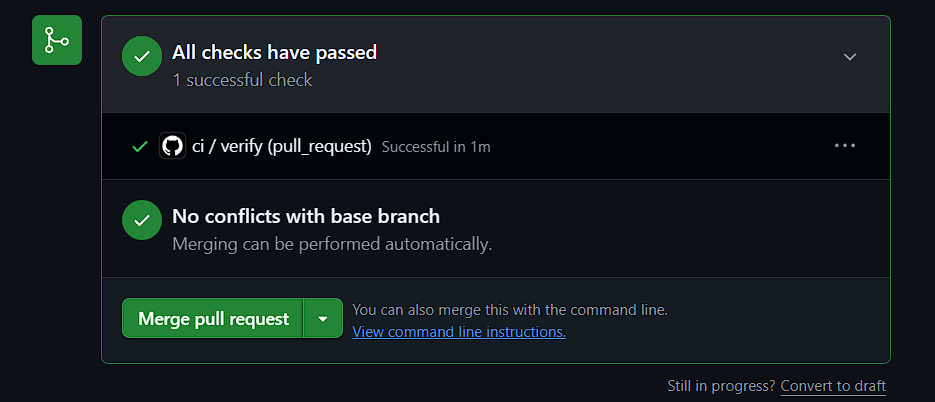

3. Nilai kesiapan tengah semester

Penilaian kesiapan dicatat pada docs/review-checklist.md. Struktur feature-first tersedia pada fitur auth dan announcements. Bukti tiga grep sterilitas Minggu 7 tersimpan pada ai_grep1.png, ai_grep2.png, dan ai_grep3.png di folder screenshots project Minggu 7.

PR #2 sudah di-merge setelah self-review dengan keputusan Approve. Saran penambahan test password tujuh karakter dan komentar regex dinilai tidak menghalangi merge sehingga tidak diterapkan.

Hasil uji manual menunjukkan perilaku aplikasi tetap seperti akhir Minggu 7, kecuali perbaikan validasi email melalui PR #2. Email tidak lengkap seperti esatovin@ ditolak dengan pesan kesalahan.

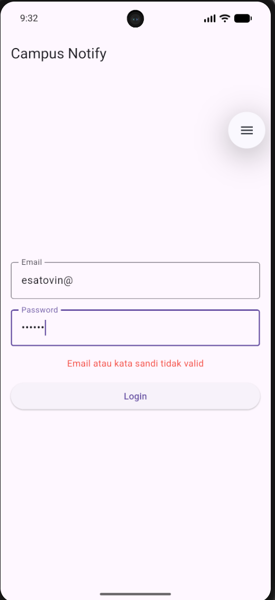

Login dengan input valid berhasil membuka halaman Home.

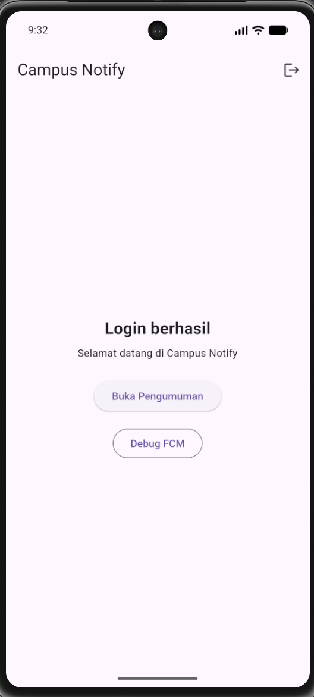

Notifikasi dapat diterima dan layar Debug FCM menunjukkan status berlangganan topik pengumuman-kampus.

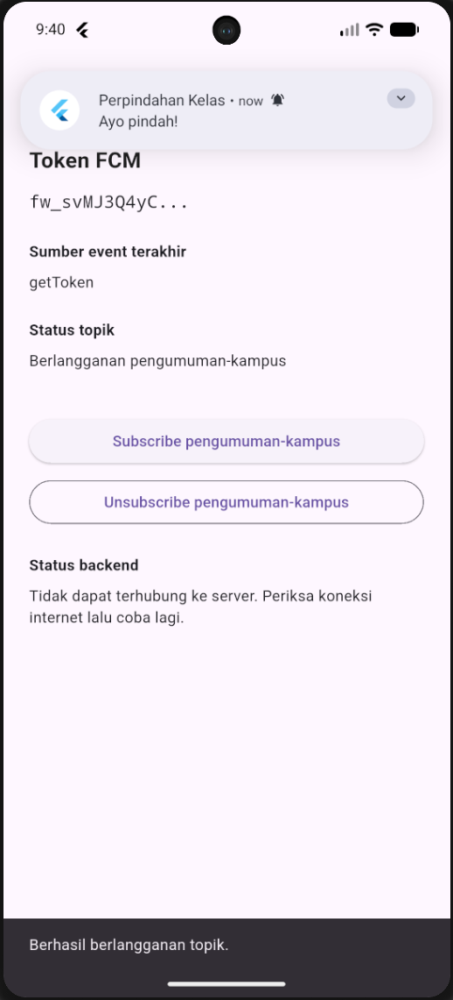

Status paruh semester

Pemeriksaan analyze, format, test, dan CI lulus. Perilaku aplikasi sudah dibandingkan dengan akhir Minggu 7 dan tetap sama, dengan perubahan validasi email sesuai PR #2.

Autentikasi masih menggunakan mock. Layar Debug FCM masih menampilkan kegagalan koneksi ke backend, sehingga integrasi backend belum dinyatakan selesai.

Review dilakukan secara mandiri melalui self-review. Issue #1 ditutup manual setelah merge karena target PR adalah develop, sedangkan default branch repository masih main.

Peta issue/PR

- Issue #1: Login validation accepts incomplete email addresses. Ditutup manual sebagai Completed setelah perbaikan di-merge.
- PR #2: fix(auth): reject invalid email addresses and add tests. Sudah di-merge ke develop setelah self-review.
- PR #3: chore(week8): add review documentation and automated checks. Memuat dokumentasi review dan workflow CI; pemeriksaan CI passed.

## AI Challenge

1. Agent yang digunakan: Codex

2. Prompt yang digunakan:

        Review PR Flutter ini sebagai senior Flutter dev.
        Konteks: feature-first Clean Architecture (presentation -> domain <- data),
        Riverpod, GoRouter, SQLite + Dio.
        Fokus: kebenaran, arsitektur, dan test. Abaikan style.
        Berikan 5 temuan teratas + level (blocker/saran)
        + alasan + usulan potongan kode perbaikan.

3. Output awal AI

Output awal review PR #2 disimpan pada docs/ai-review-output-awal.md.

4. AI Verification Checklist

Verifikasi dan tabel usulan dibanding keputusan final dicatat pada docs/ai-review-vs-keputusan.md.

- Apakah temuan benar-benar ada? Buktikan dengan grep, test gagal, atau reproduksi manual.

Jawaban:
Ya. Dua temuan validasi terbukti melalui pengujian verifikasi terhadap versi PR #2:
Temuan 1: mahasiswa@kampus..ac.id dan mahasiswa@.kampus.ac.id masih diteruskan ke repository.
Temuan 2: .mahasiswa@kampus.ac.id, mahasiswa.@kampus.ac.id, dan maha..siswa@kampus.ac.id masih diteruskan ke repository.
Test verifikasi sementara mengharapkan AuthFailure, tetapi hasil aktual failure adalah null. Hasilnya adalah 19 test lulus dan 10 test gagal: tujuh terkait domain dan tiga terkait posisi titik pada local-part. Cuplikan bukti disimpan dalam docs/ai-verification-bukti.md. Test tambahan tersebut tidak disertakan pada kode project yang dipertahankan.
Temuan 3–5 merupakan kekurangan cakupan test, bukan bukti bahwa perilaku aplikasi saat ini salah.

- Apakah usulan melanggar dependency rule (domain mengimpor Flutter/Dio/SQLite)? Tolak bila ya.

Jawaban:
Tidak. Usulan validasi menggunakan Dart murni pada use case Login. Domain tetap bergantung pada kontrak AuthRepository.
Pencarian import pada domain auth tidak menemukan import package Flutter, Dio, SQLite, maupun implementasi data. Penggunaan flutter_test berada pada folder test sehingga tidak melanggar dependency rule.

- Apakah AI hanya nitpick style yang seharusnya ditangani formatter/CI?

Jawaban:
Tidak. Temuan membahas penerimaan input tidak valid dan cakupan pengujian. Permasalahan tersebut tidak dapat diselesaikan oleh formatter. Static analysis juga tidak membuktikan bahwa aturan validasi sudah benar.

- Minimal 2 temuan AI terbukti benar dengan bukti, dan minimal 1 temuan ditolak dengan alasan tertulis.

Jawaban:
Temuan 1 dan 2 terbukti benar melalui test verifikasi sementara yang gagal terhadap versi PR #2.
Usulan temuan 5, yaitu menambahkan test forwarding khusus LocalFailure, ditolak untuk perubahan ini. Login meneruskan hasil repository secara langsung tanpa percabangan berdasarkan subtipe Failure. Test yang tersedia sudah memeriksa bahwa objek failure yang sama dikembalikan.
Pengulangan test untuk subtipe lain memberikan manfaat tambahan yang terbatas. Penanganan kegagalan penyimpanan lebih tepat diuji pada AuthRepositoryImpl. Penolakan ini tidak berarti kegagalan penyimpanan sudah teruji.

- Keputusan final dan alasan teknis Anda, boleh berbeda dari saran AI selama berargumen.

Jawaban:
Temuan 1 sampai 4 diterima sebagai rekomendasi dan belum diterapkan pada kode.

Temuan 1: perketat pemeriksaan label domain agar alamat tidak valid ditolak sebelum repository dipanggil.
Temuan 2: periksa posisi titik pada local-part tanpa tanda kutip, sambil menjaga bentuk valid yang sebelumnya didukung.
Temuan 3: tambahkan test password lebih dari enam karakter untuk melindungi aturan panjang minimal.
Temuan 4: tambahkan variasi email valid agar pengetatan validator tidak menolak plus-tag dan subdomain.
Tolak usulan temuan 5: prioritaskan pengujian jalur kegagalan penyimpanan pada lapisan data daripada mengulang test forwarding tanpa jalur eksekusi berbeda.

## Refactoring, Testing, dan Error Umum

1. Refactoring Challenge
    a. Penerapan saran review sejawat dan AI:

   - Menambahkan komentar penjelasan format dasar email pada use case Login (lib/features/auth/domain/usecases/login.dart) untuk memperjelas aturan regex bagi reviewer.

   - Menambahkan unit test password lebih dari enam karakter (panjang 7 karakter) pada test/login_test.dart untuk mengunci batasan minimal agar tidak terjadi regresi menjadi aturan tepat enam karakter.

   - Menambahkan unit test untuk variasi email valid (subdomain, plus-tag +, dan titik pada local-part) guna memastikan validator tidak menolak format email yang sah.

    b. Otomatisasi style dengan CI:

   - Menambahkan step dart format --output=none --set-exit-if-changed . ke dalam workflow CI GitHub Actions (.github/workflows/ci.yml).

   - Seluruh 31 file telah diformat menggunakan dart format . sehingga jika terdapat kode kotor yang didorong ke pull request, CI akan otomatis menolak (fail) sebelum tahap review manusia.

    c. Strategi pemecahan PR besar (> 300 baris):

   - Menghindari penggabungan banyak layer dalam satu PR besar dengan memecahnya menjadi 2–3 PR berurutan yang masing-masing dapat direview dalam waktu < 15 menit:

     - PR 1: Kontrak domain & use case beserta unit test (< 150 baris).

     - PR 2: Implementasi data layer (remote/local data source & repository) (< 200 baris).

     - PR 3: Integrasi presentation layer (UI, provider, dan routing) (< 150 baris).

   - PR yang dikerjakan pada tahap ini (feature/refactoring-ci-and-error-handling) menjaga prinsip PR kecil dengan cakupan perubahan terfokus hanya pada 3 berkas (~45 baris).

2. Testing: Review Tanpa Dijalankan Tidak Sah

Setiap PR yang mengubah perilaku wajib menyertakan bukti uji mesin dan langkah manual:

- dart format: 31 berkas diperiksa, 0 changed.

- flutter analyze: No issues found! (0 issues).

- flutter test: 31 test lulus (All tests passed!), bertambah 4 test dari baseline sebelumnya.

Berikut merupakan bukti pemeriksaan flutter analyze:

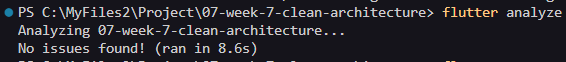

Berikut merupakan bukti pemeriksaan flutter test:

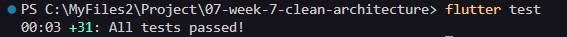

Langkah pengujian manual untuk boundary pada login.

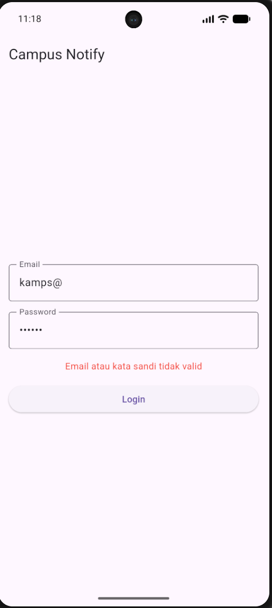

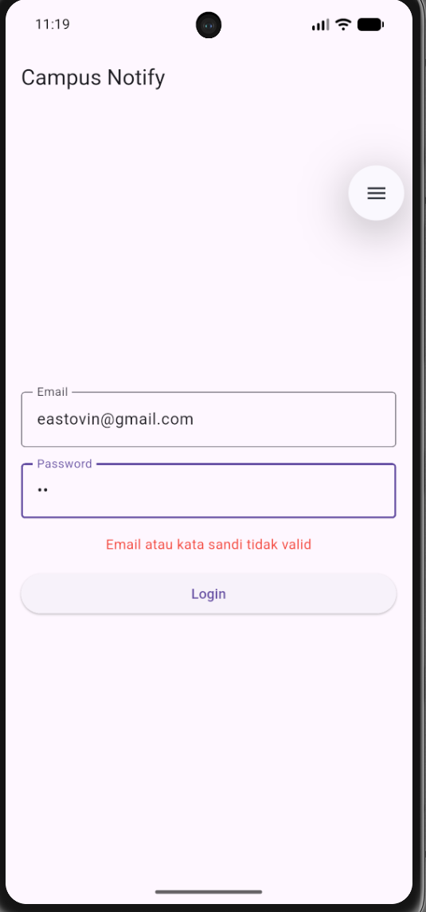
