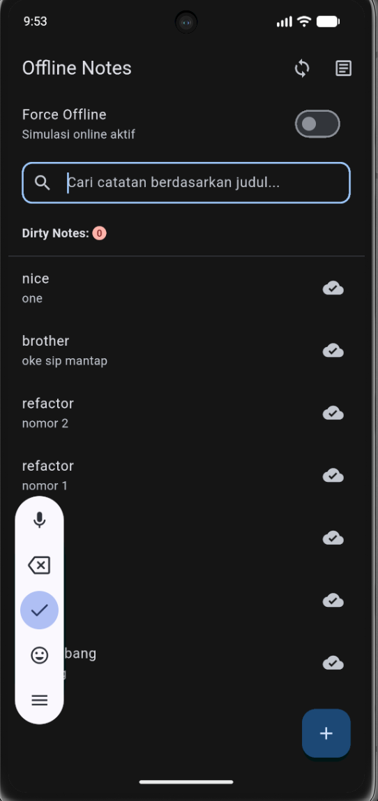
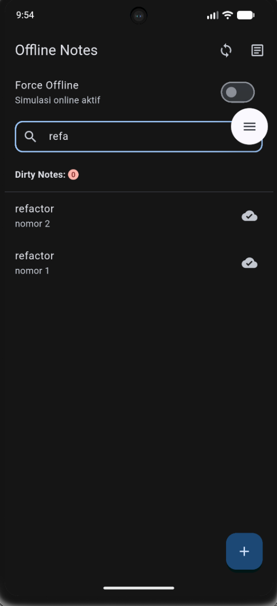
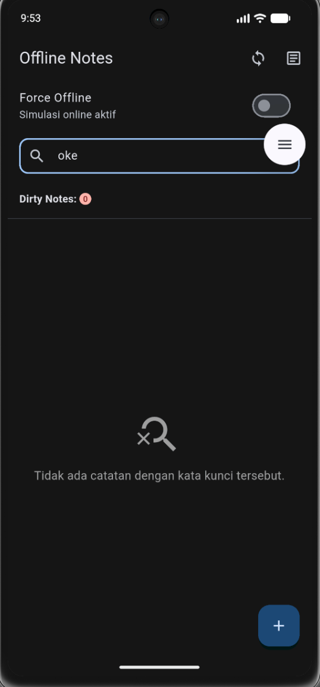

# 09-week-9-ai-assisted-development

## Tujuan Pembelajaran

Setelah menyelesaikan praktikum ini, mahasiswa mampu:
1. Menjelaskan workflow AI-assisted development (Prompt, Generate, Verify, Test, Refactor, Explain).
2. Menulis prompt dan konteks yang efektif untuk fitur Flutter kecil menggunakan Formula 5 Slot.
3. Mengenali halusinasi dan keterbatasan AI pada kode Flutter (misal API kadaluarsa pada Riverpod 3).
4. Melakukan debugging dan refactoring kode hasil usulan AI ke struktur Clean Architecture.
5. Menguji kode hasil AI secara komprehensif menggunakan flutter analyze dan unit/widget test.
6. Mendokumentasikan interaksi AI, prompt, keputusan terima/tolak, dan bukti uji pada docs/ai-log.md.

---

## Konsep Workflow AI dan Halusinasi

### 1. Siklus 6 Langkah (Generate sampai Explain)

Alur kerja AI-assisted development terdiri dari 6 tahapan:
1. Prompt: menulis instruksi jelas beserta konteks proyek.
2. Generate: AI mengusulkan potongan kode.
3. Verify: memeriksa kode, mengecek file, dan memvalidasi ketersediaan API nyata.
4. Test: menjalankan flutter analyze dan pengujian unit/widget test.
5. Refactor: menata ulang kode agar sesuai kaidah Clean Architecture dan standar versi library.
6. Explain: memahami alur logika sehingga developer mampu menjelaskan kode tanpa membuka AI.

AI berperan mengusulkan kode, sedangkan keputusan teknis dan validasi sepenuhnya berada di tangan developer. Menerima usulan AI secara mentah tanpa verifikasi disebut vibe coding, yang berisiko menimbulkan bug terselubung dan pembengkakan biaya pemeliharaan aplikasi.

### 2. Pemetaan Area Kemampuan AI

- Area Kuat: Pembuatan kode boilerplate, pola umum, draf unit test, dan draf dokumentasi. Sikap: manfaatkan untuk efisiensi, namun tetap uji kebenaran logikanya.
- Area Lemah: Penggunaan API versi terbaru dengan breaking changes, logika bisnis spesifik, dan struktur state yang kompleks. Sikap: lakukan verifikasi manual ke dokumentasi resmi atau file pubspec.lock.
- Area Berbahaya: Penanganan token autentikasi, query SQL mentah, dan aturan keamanan. Sikap: jangan menyertakan secret atau data sensitif ke AI, tulis dan audit bagian ini secara manual.

### 3. Tiga Pola Halusinasi Flutter

1. Method Fiktif: AI membuat method atau getter yang tidak pernah ada pada SDK atau package yang digunakan.
2. Package Kadaluarsa: AI menggunakan sintaks library versi lama yang sudah tidak didukung pada versi package aktif (misalnya mengusulkan StateProvider pada flutter_riverpod versi 3).
3. Logika Yakin Tapi Salah: AI menyusun logika yang tampak meyakinkan namun keliru (misalnya filter pencarian case-sensitive atau penggabungan string query SQL yang rentan injection).

---

## Praktikum 1: Prompt dan Context Engineering

Praktikum ini menerapkan penambahan fitur pencarian catatan (search notes) dan tampilan kosong (empty state) pada project 05-week-5-local-storage-offline-first.

### 1. Penerapan Formula 5 Slot

Satu prompt yang efektif memenuhi lima slot informasi:
1. Peran: Senior Flutter dan Clean Architecture Developer.
2. Konteks: Project 05-week-5-local-storage-offline-first, Flutter 3, flutter_riverpod 3.4.3, SQLite sqflite 2.4.4, model Note(id, title, body, updatedAt, dirty), dan NoteRepository.
3. Tugas: Tambahkan fungsi searchNotes pada NoteRepository, integrasikan TextField pencarian pada NotesPage, dan tampilkan Empty State jika hasil pencarian kosong.
4. Batas: Dilarang memanggil SQLite langsung dari widget, jangan gunakan package fiktif, gunakan NotifierProvider Riverpod 3 (bukan StateProvider), dan pertahankan skema tabel database.
5. Output: Kode repository, provider dan widget UI, serta minimal 3 test case (pencarian cocok, case-insensitive, dan empty state).

### 2. Komparasi Prompt Buruk vs Prompt Baik

Prompt Buruk:
"buatkan search notes yang keren di flutter dengan sqlite dan riverpod"

Kelemahan: Sangat ambigu. AI tidak mengetahui model data yang dipakai, berpotensi memanggil database langsung dari widget UI sehingga merusak arsitektur, dan tidak menghasilkan pengujian otomatis.

Prompt Baik:
"Tambah search judul notes pada project 05-week-5-local-storage-offline-first. Arsitektur: presentation -> repository. Jangan panggil SQLite dari widget. Gunakan NotifierProvider (Riverpod 3.x), dukung pencarian case-insensitive, sertakan empty state dan unit/widget test."

Kelebihan: Memberikan batasan teknis yang spesifik, mematuhi separation of concerns, serta menuntut adanya bukti uji otomatis.

### 3. Beri Konteks, Bukan Secret

- Informasi yang disertakan: Struktur folder project, potongan kode NoteRepository dan model Note, serta versi library dari pubspec.yaml.
- Informasi yang tidak disertakan: Token autentikasi, kredensial backend, file lingkungan (.env), atau file repository yang tidak relevan.

---

## Praktikum 2: Generate dan Verifikasi Search

Praktikum 2 melakukan verifikasi ketat terhadap kode pencarian yang dihasilkan AI melalui protokol 6 langkah dan pembuktian empiris terhadap halusinasi AI.

### 1. Generate Satu Fitur Kecil

Fitur dibatasi hanya pada pencarian judul catatan dan tampilan empty state agar cakupan review tetap terukur dan mudah diverifikasi. Seluruh prompt mentah dan kode awal AI didokumentasikan pada docs/ai-log.md.

### 2. Pelaksanaan Verifikasi 6 Langkah

1. Membaca tiap baris kode: Meneliti struktur data dan logika filter. Ditemukan bahwa AI mengusulkan pemanggilan synchronous pada method repository asinkron serta menggunakan state management lama.
2. Cek import domain: Memastikan berkas domain lib/data/local/note.dart steril tanpa mengimpor Flutter, Dio, maupun SQLite. Hasil pengecekan import bernilai nol sehingga aturan Clean Architecture terpenuhi.
3. Cek API nyata: Melakukan pengecekan pada pubspec.lock dan autocomplete SDK. Ditemukan bahwa StateProvider telah dihapus pada flutter_riverpod versi 3.4.3.
4. Jalankan flutter analyze: Menjalankan static analysis hingga memperoleh status No issues found tanpa ada error maupun warning.
5. Tulis unit test sukses dan gagal: Membuat pengujian fungsi filterNotes untuk memverifikasi pencarian yang mengabaikan huruf besar/kecil (sukses) dan kata kunci yang tidak cocok (menghasilkan kosong).
6. Uji manual tiga kondisi: Menjalankan aplikasi untuk menguji kondisi query kosong (seluruh catatan tampil), query cocok (catatan tersaring), dan query tidak cocok (tampilan empty state aktif).

### 3. Bukti Pengujian Unit Test

Berikut implementasi fungsi filterNotes pada lapisan data domain murni (lib/data/local/note.dart):

```dart
List<Note> filterNotes(List<Note> notes, String query) {
  return const SearchNotes().call(notes: notes, query: query);
}
```

Berikut unit test verifikasi yang membuktikan kebenaran logika filter (test/note_search_test.dart):

```dart
test('filter abaikan huruf besar/kecil', () {
  expect(filterNotes(list, 'belanja'), hasLength(2));
});

test('query tak cocok kembalikan kosong', () {
  expect(filterNotes(list, 'zzz-tak-ada'), isEmpty);
});
```

### 4. Bukti Wajib: Halusinasi dan Bug AI

Verifikasi berhasil menemukan satu halusinasi fatal dan satu kelemahan logika dari usulan awal AI:

1. Halusinasi Package Kadaluarsa (StateProvider):
   AI mengusulkan deklarasi final searchQueryProvider = StateProvider(ref) => ''.
   Cara membuktikan:
   Saat kode dijalankan, compiler Dart langsung menghasilkan error kompilasi:
   Error: Method not found: StateProvider.
   Pemeriksaan pada pubspec.yaml menunjukkan flutter_riverpod berada pada versi 3.4.3. Pada versi ini StateProvider sudah tidak tersedia dan digantikan oleh NotifierProvider.

2. Celah Logika Case-Sensitivity:
   AI awalnya mengusulkan note.title.contains(query) tanpa fungsi toLowerCase().
   Cara membuktikan:
   Pencarian kata kunci belanja gagal mencocokkan catatan berjudul BELANJA Bulanan sehingga menghasilkan data yang tidak lengkap. Logika ini diperbaiki dengan menyamakan seluruh teks ke huruf kecil sebelum pembandingan.

---

## Praktikum 3: Debug dan Refactor

Praktikum 3 melakukan proses debugging dengan pendekatan test merah (red test), mengisolasi logika ke use case murni, dan merefaktor arsitektur kode ke layer yang tepat dengan fungsi modular berukuran di bawah 40 baris.

### 1. Debug dengan Test Merah

1. Reproduksi Bug:
   Langkah: Pengguna melakukan pencarian dengan kata kunci yang terdapat pada isi catatan (body) atau mengetik kata kunci dengan spasi di awal dan akhir (misal '   flutter   ').
   Input pemicu: Pencarian kata kunci pada atribut body dan query dengan whitespace.
   Hasil awal: Pencarian gagal menemukan catatan (empty state) karena usulan awal AI hanya mencocokkan atribut title secara ketat tanpa pengecekan body dan tanpa normalisasi trim.

2. Isolasi Logika:
   Aturan penyaringan dipisahkan dari presentation layer dan dipindahkan ke use case domain murni SearchNotes pada lib/domain/usecases/search_notes.dart.

3. Test Merah (Red Test):
   Dibuat unit test yang mengekspos kegagalan tersebut sebelum perbaikan:
   - Test mencari kata kunci pada isi body catatan.
   - Test menangani spasi berlebih pada awal dan akhir query.
   Saat pertama kali dijalankan terhadap logika lama, test ini gagal (merah).

4. Perbaikan Kecil dan Test Hijau:
   Logika pada SearchNotes diperbaiki dengan menambahkan normalisasi trim() dan pencocokan ganda pada title dan body:
   final titleMatch = note.title.toLowerCase().contains(trimmed);
   final bodyMatch = note.body.toLowerCase().contains(trimmed);
   return titleMatch || bodyMatch;
   Setelah perbaikan kecil ini, seluruh test suite langsung lulus (hijau).

5. Pencatatan Akar Masalah:
   Akar masalah didokumentasikan pada docs/ai-log.md, yaitu asumsi awal AI yang membatasi filter hanya pada satu field tanpa memvalidasi kebutuhan pencarian konten catatan.

### 2. Refactor ke Layer yang Benar

Arsitektur project ditata ulang mengikuti hierarki Clean Architecture:
- Widget (UI saja): NotesPage dipecah menjadi komponen modular (_NotesSearchBar, _NotesContent, _NotesEmptyState) tanpa logika query maupun database.
- Notifier (State saja): SearchQueryNotifier bertugas mengelola state teks pencarian secara reaktif.
- Use Case (Aturan filter): SearchNotes bertanggung jawab penuh atas aturan penyaringan catatan secara murni.
- Repository (Data access): NoteRepository bertugas menangani akses SQLite dan komunikasi jaringan.

Pemeriksaan ukuran fungsi memastikan seluruh fungsi pada NotesPage berada di bawah 40 baris, dan tidak terdapat pemanggilan database secara langsung dari widget.

### 3. Kode Hasil Refactoring Use Case

Berikut implementasi use case SearchNotes (lib/domain/usecases/search_notes.dart):

```dart
import '../../data/local/note.dart';

class SearchNotes {
  const SearchNotes();

  List<Note> call({
    required List<Note> notes,
    required String query,
  }) {
    final trimmed = query.trim().toLowerCase();
    if (trimmed.isEmpty) {
      return notes;
    }

    return notes.where((note) {
      final titleMatch = note.title.toLowerCase().contains(trimmed);
      final bodyMatch = note.body.toLowerCase().contains(trimmed);
      return titleMatch || bodyMatch;
    }).toList();
  }
}
```

---

## AI Challenge

### 1. Prompt Challenge Review

Prompt yang digunakan untuk meminta AI mereview kode pencarian:

Review kode search Flutter ini sebagai senior dev.
Konteks: feature-first (presentation->domain<-data),
Riverpod, SQLite + Dio.
Fokus: kebenaran, arsitektur, test. Abaikan style.
Beri 3 temuan + level blocker/saran + alasan.

### 2. Ringkasan Tiga Temuan Review AI

1. Temuan 1 (Level Blocker): Inkonsistensi pencarian antara layer SQL dan in-memory. Pada use case domain, pencarian mencakup atribut title dan body. Namun pada NoteRepository.searchNotes, query SQL SQLite hanya memeriksa kolom title. Hal ini menyebabkan inkonsistensi data jika query database langsung dipanggil.
2. Temuan 2 (Level Saran): Kurangnya pengujian boundary pada catatan dengan body kosong (body: ''). Test yang ada belum menguji apakah catatan tanpa body tetap aman dicari tanpa memicu error atau string null.
3. Temuan 3 (Level Saran): Rekomendasi menambahkan tabel virtual SQLite FTS5 (Full-Text Search) atau endpoint remote search via Dio untuk pencarian fuzzy berskala besar.

### 3. AI Verification Checklist dan Keputusan

Pemeriksaan dan verifikasi terhadap temuan AI menghasilkan keputusan teknis berikut:

| No | Temuan AI dan Level | Hasil Verifikasi | Keputusan Final dan Alasan Teknis |
| --- | --- | --- | --- |
| 1 | Blocker: Inkonsistensi filter SQL vs in-memory. | Terbukti. Pemeriksaan pada note_repository.dart menunjukkan query SQL hanya mencari pada kolom title, berbeda dengan use case domain yang memeriksa title dan body. | Diterima dan Diperbaiki. Query SQL pada NoteRepository.searchNotes diperbarui menjadi LOWER(title) LIKE ? OR LOWER(body) LIKE ? agar kedua layer konsisten. |
| 2 | Saran: Kurang pengujian boundary body kosong. | Terbukti celah cakupan test. Unit test sebelumnya hanya menguji catatan yang memiliki isi body lengkap. | Diterima dan Ditambahkan Test. Dibuat unit test baru untuk memastikan catatan dengan body kosong tetap aman dicari berdasarkan judul. |
| 3 | Saran: Tambahkan FTS5 atau remote search Dio. | Tidak relevan dengan skala aplikasi. Aplikasi ini berfokus pada offline-first personal notes dengan jumlah catatan lokal ringan. | Ditolak. Penambahan virtual table FTS5 atau remote search menambah kompleksitas skema migrasi database dan dependensi jaringan yang tidak diperlukan pada skala data lokal (over-engineering). |

### 4. Keputusan Tindak Lanjut Tiap Berkas

- lib/data/repositories/note_repository.dart: Terima dan perbaiki. Menyelaraskan query SQL dengan menambahkan pencarian pada kolom body.
- test/note_search_test.dart: Terima dan refactor. Menambahkan pengujian boundary untuk pencarian isi body dan catatan dengan body kosong.
- lib/domain/usecases/search_notes.dart: Pertahankan kode yang ada. Use case domain sudah murni dan memenuhi kriteria Clean Architecture.

---

## Refactoring, Testing, dan Error Umum

### 1. Refactoring Challenge

1. Memperkecil hasil kode AI di atas 80 baris menjadi fungsi dan use case kecil yang modular. File notes_page.dart dipecah menjadi komponen-komponen terpisah (_NotesSearchBar, _NotesContent, _NotesEmptyState) dengan panjang tiap fungsi di bawah 40 baris.
2. Memindahkan logika filter pencarian dari widget ke use case domain murni SearchNotes (lib/domain/usecases/search_notes.dart) sehingga terisolasi dan mudah diuji secara independen.
3. Menghapus ketergantungan lintas layer. Entitas domain dan use case diverifikasi steril tanpa mengimpor paket Flutter, Dio, maupun SQLite.

### 2. Testing Terfokus

Pengujian otomatis dijalankan secara spesifik pada test suite search_filter_test.dart:

Perintah uji:
flutter test test/search_filter_test.dart

Cakupan pengujian pada test/search_filter_test.dart:
- Test filter mengabaikan huruf besar/kecil (case-insensitive).
- Test query tidak cocok mengembalikan list kosong (empty state logic).
- Test filter mencocokkan kata kunci pada isi body catatan.
- Test filter mengabaikan spasi berlebih pada awal dan akhir query.
- Test filter query kosong mengembalikan seluruh catatan.
- Test filter aman terhadap catatan dengan body kosong.
- Widget test interaktif pembuktian tampilan Empty State saat pencarian tidak cocok beserta pemulihan data saat tombol clear ditekan.

Hasil pengujian search_filter_test.dart: 7 test lulus (All tests passed!).

### 3. Error Umum dan Solusinya

Berikut merupakan pemetaan gejala error umum yang sering muncul saat bekerja dengan asisten AI beserta solusi teknis yang diterapkan:

| Gejala | Penyebab Umum | Solusi yang Diterapkan |
| --- | --- | --- |
| Method tidak ada saat kompilasi | Halusinasi API atau package kadaluarsa | Periksa ketersediaan method melalui autocomplete IDE dan dokumentasi resmi pub.dev serta pubspec.lock. |
| Import lintas layer (domain import Flutter/Dio/SQLite) | Konteks prompt kurang spesifik | Tegaskan batasan arsitektur pada prompt dan refactor kode ke class use case murni. |
| Seluruh test langsung merah | Instruksi prompt terlalu besar dan rumit | Pecah tugas menjadi satu fitur kecil dengan satu test case pembukti terlebih dahulu. |
| Prompt perbaikan diulang-ulang tanpa hasil | Tanpa isolasi dan reproduksi masalah konkret | Tuliskan langkah reproduksi input pemicu dan buat unit test merah pembukti sebelum meminta perbaikan. |
| Developer tidak mampu menjelaskan kode | Menerima kode AI mentah-mentah (vibe coding) | Baca ulang baris demi baris, sederhanakan logika, dan buang kode asing yang tidak dipahami. |

### 4. Checklist Verifikasi Mandiri

- [x] Prompt disusun dengan Formula 5 Slot dan konteks lengkap terdokumentasi di docs/ai-log.md.
- [x] flutter analyze bersih (0 warning/error), dart format rapi, dan seluruh test suite flutter test hijau.
- [x] Minimal 1 temuan AI dibuktikan benar (kueri SQL pencarian body) dan 1 temuan ditolak beralasan teknis (FTS5 / Dio remote search).
- [x] Developer menguasai alur kerja Clean Architecture dan mampu menjelaskan setiap baris keputusan kode tanpa membuka AI.

---

## Hasil Pengujian dan Tampilan Aplikasi

### 1. Bukti Pemeriksaan Mesin

Pemeriksaan dijalankan pada direktori project 05-week-5-local-storage-offline-first:
- dart format: 22 file diperiksa, 0 changed.
- flutter analyze: No issues found! (0 issues).
- flutter test: Seluruh 26 test lulus (All tests passed!), mencakup 4 test bawaan, 15 test pada note_search_test.dart, dan 7 test pada search_filter_test.dart.

### 2. Tampilan Hasil Uji Manual

Berikut merupakan tampilan halaman utama catatan dengan kolom pencarian:



Berikut merupakan tampilan ketika catatan berhasil ditemukan berdasarkan kata kunci pencarian:



Berikut merupakan tampilan Empty State ketika kata kunci pencarian tidak ditemukan:



---

## Dokumentasi Log AI

Catatan lengkap prompt, evaluasi usulan, dan log verifikasi dicatat pada docs/ai-log.md.
