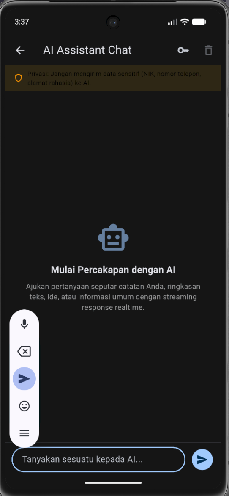
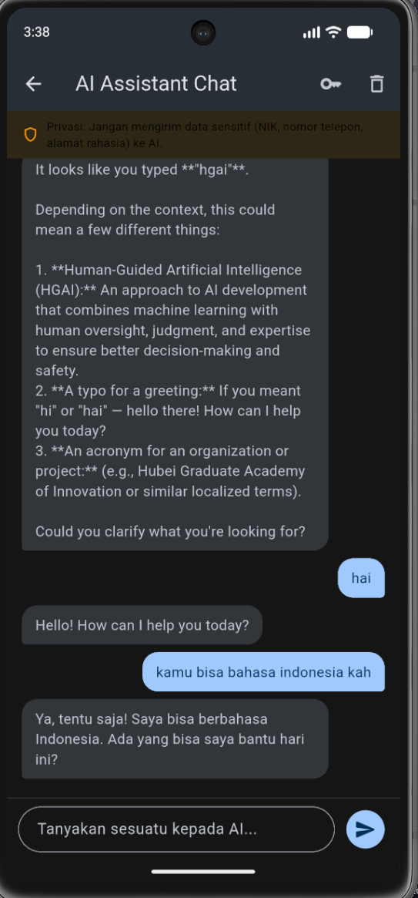

# 10-week-10-ai-feature-integration

## Tujuan Pembelajaran

Setelah menyelesaikan praktikum ini, mahasiswa mampu:
1. Memahami konsep integrasi LLM API ke dalam aplikasi mobile Flutter.
2. Merancang antarmuka percakapan (chat interface) dengan dukungan streaming response secara realtime.
3. Mengintegrasikan layanan AI eksternal seperti Google Gemini API dengan aman.
4. Menerapkan prompt design yang aman dan efektif pada lingkungan mobile.
5. Menangani aspek privasi pengguna, pengelolaan biaya API, penanganan error, dan desain fallback.
6. Mengevaluasi pengalaman pengguna (UX) pada fitur kecerdasan buatan di perangkat bergerak.

---

## Konsep Integrasi Fitur AI

### 1. Apa itu Integrasi Fitur AI?

Integrasi fitur AI memungkinkan aplikasi mobile berkomunikasi dengan model kecerdasan buatan di cloud untuk menyediakan layanan cerdas kepada pengguna:
- Chat Asisten: Tanya jawab interaktif dalam waktu nyata menggunakan LLM API (seperti Google Gemini).
- OCR (Optical Character Recognition): Ekstraksi teks dari gambar atau dokumen catatan.
- Speech-to-Text: Mengonversi input suara pengguna menjadi format teks.
- Image Understanding: Analisis gambar dan pembuatan deskripsi konten visual.
- Recommendation: Rekomendasi personalisasi berdasarkan catatan atau preferensi pengguna.

### 2. Arsitektur Integrasi AI

Alur komunikasi fitur AI dirancang dengan pemisahan tanggung jawab yang jelas:
- Flutter UI (Presentation): Menampilkan pesan, indikator loading, dan streaming bubble respons AI.
- AI Service Layer: Bertugas menyusun format request JSON, mengelola otentikasi header, dan mem-parsing respon Server-Sent Events (SSE).
- Secure Storage Layer: Menyimpan API Key pengguna secara terenkripsi menggunakan Flutter Secure Storage pada keystore perangkat.
- Cloud AI Provider: Endpoint Google Gemini API yang memproses inference prompt.

Aturan keamanan arsitektur:
- Kunci API tidak boleh disimpan secara hardcoded di dalam kode sumber aplikasi.
- Gunakan Flutter Secure Storage untuk menyimpan token atau API Key secara aman.
- Perhatikan kuota dan batasan rate limit request per menit.
- Terapkan mekanisme validasi lokal untuk mencegah data pribadi sensitif terkirim ke server AI eksternal.

### 3. Prompt Design untuk Mobile

Struktur prompt terarah untuk aplikasi mobile:
- System prompt: Menetapkan persona asisten, batasan domain, dan gaya bahasa respon yang ringkas.
- User prompt: Pertanyaan atau instruksi dari pengguna melalui kolom input chat.
- Konteks: Data pendukung yang relevan (misalnya ringkasan catatan pengguna) tanpa menyertakan kredensial rahasia.
- Batasan keamanan: Larangan keras menyertakan NIK, nomor telepon, alamat rumah, atau data rahasia perbankan.

---

## Praktikum: Chat Interface dengan AI

Praktikum ini mengimplementasikan integrasi Google Gemini ke dalam project 05-week-5-local-storage-offline-first.

### Langkah 1: Penambahan Dependensi

Dependensi berikut ditambahkan ke dalam berkas pubspec.yaml:

```yaml
dependencies:
  flutter:
    sdk: flutter
  cupertino_icons: ^1.0.8
  flutter_riverpod: ^3.4.3
  shared_preferences: ^2.5.5
  sqflite: ^2.4.4
  path: ^1.9.1
  dio: ^5.11.1
  go_router: ^18.0.1
  http: ^1.6.0
  flutter_secure_storage: ^11.2.0
```

### Langkah 2: Pembuatan AI Service

Berkas lib/ai/ai_service.dart dibuat untuk menangani komunikasi HTTP POST ke endpoint Google Gemini API:

```dart
import 'dart:convert';
import 'package:flutter_secure_storage/flutter_secure_storage.dart';
import 'package:http/http.dart' as http;

class AiService {
  final FlutterSecureStorage _storage;
  final http.Client _client;
  final String _apiUrl;

  static const String defaultApiUrl =
      'https://generativelanguage.googleapis.com/v1beta/models/gemini-3.5-flash:generateContent';

  AiService({
    FlutterSecureStorage? storage,
    http.Client? client,
    String? apiUrl,
  })  : _storage = storage ?? const FlutterSecureStorage(),
        _client = client ?? http.Client(),
        _apiUrl = _resolveApiUrl(apiUrl);

  static String _resolveApiUrl(String? url) {
    if (url == null || url.isEmpty || url.contains('gemini-pro:')) {
      return defaultApiUrl;
    }
    return url;
  }

  Future<String> ask(String question) async {
    final apiKey = await _storage.read(key: 'ai_api_key');
    if (apiKey == null || apiKey.isEmpty) {
      throw Exception('API key tidak tersedia. Silakan atur di pengaturan.');
    }

    final response = await _client.post(
      Uri.parse('$_apiUrl?key=$apiKey'),
      headers: {'Content-Type': 'application/json'},
      body: jsonEncode({
        'contents': [
          {
            'parts': [
              {'text': question}
            ]
          }
        ]
      }),
    );

    if (response.statusCode == 200) {
      final data = jsonDecode(response.body);
      return data['candidates'][0]['content']['parts'][0]['text'];
    } else {
      throw Exception('Gagal memanggil AI API: ${response.statusCode}');
    }
  }

  Stream<String> askStream(String question) async* {
    final apiKey = await _storage.read(key: 'ai_api_key');
    if (apiKey == null || apiKey.isEmpty) {
      throw Exception('API key tidak tersedia. Silakan atur di pengaturan.');
    }

    final streamUrl = _apiUrl.contains('generateContent')
        ? _apiUrl.replaceFirst('generateContent', 'streamGenerateContent')
        : _apiUrl;

    final request = http.Request(
      'POST',
      Uri.parse('$streamUrl?alt=sse&key=$apiKey'),
    );
    request.headers['Content-Type'] = 'application/json';
    request.body = jsonEncode({
      'contents': [
        {
          'parts': [
            {'text': question}
          ]
        }
      ]
    });

    final streamedResponse = await _client.send(request);
    if (streamedResponse.statusCode != 200) {
      final body = await streamedResponse.stream.bytesToString();
      throw Exception(
        'Gagal memanggil AI API: ${streamedResponse.statusCode} - $body',
      );
    }

    String buffer = '';
    await for (final chunk in streamedResponse.stream.transform(utf8.decoder)) {
      buffer += chunk;
      final lines = buffer.split('\n');
      buffer = lines.removeLast();

      for (final line in lines) {
        final trimmed = line.trim();
        if (trimmed.startsWith('data: ')) {
          final jsonStr = trimmed.substring(6).trim();
          if (jsonStr.isEmpty || jsonStr == '[DONE]') continue;
          try {
            final data = jsonDecode(jsonStr);
            final candidates = data['candidates'] as List?;
            if (candidates != null && candidates.isNotEmpty) {
              final parts = candidates[0]['content']?['parts'] as List?;
              if (parts != null && parts.isNotEmpty) {
                final text = parts[0]['text'] as String?;
                if (text != null && text.isNotEmpty) {
                  yield text;
                }
              }
            }
          } catch (_) {}
        }
      }
    }
  }

  Future<void> saveApiKey(String key) async {
    await _storage.write(key: 'ai_api_key', value: key);
  }

  Future<String?> getApiKey() async {
    return _storage.read(key: 'ai_api_key');
  }

  Future<void> removeApiKey() async {
    await _storage.delete(key: 'ai_api_key');
  }
}
```

Fitur utama pada AiService:
1. Pengecekan keberadaan kunci API pada storage terenkripsi sebelum request dikirim.
2. Method ask untuk permintaan synchronous standar.
3. Method askStream yang memanfaatkan Server-Sent Events (SSE) streamGenerateContent agar respon diterima kata demi kata secara responsif.
4. Method saveApiKey, getApiKey, dan removeApiKey untuk siklus pengelolaan kunci API pengguna secara mandiri.

### Langkah 3: Pembuatan Chat Screen dan Integrasi UI

Berkas lib/features/chat_screen.dart dibuat dengan komponen berikut:
1. AppBar yang dilengkapi ikon pengaturan API Key dan tombol bersihkan chat.
2. Banner peringatan privasi di bagian atas layar untuk mengingatkan pengguna agar tidak membagikan NIK atau nomor telepon rahasia.
3. Fitur filter privasi otomatis: sistem mendeteksi pola NIK 16 digit atau nomor telepon pada input teks dan memunculkan dialog konfirmasi sebelum pesan diteruskan ke cloud AI.
4. Tampilan Empty State yang informatif saat percakapan baru dimulai.
5. Bubble chat dengan styling kontras antara pesan pengguna dan pesan asisten AI.
6. Indikator loading dan efek animasi streaming saat AI sedang memproses teks jawaban.

Navigasi diintegrasikan ke lib/router.dart dengan route /chat, serta tombol akses langsung di AppBar halaman utama NotesPage.

---

## Praktikum 2: OCR, Speech-to-Text, dan Image Understanding

Praktikum ini memperluas kemampuan kecerdasan buatan aplikasi dengan integrasi multimodal (pengolahan teks, gambar, dan audio).

### 1. OCR (Optical Character Recognition)

Fitur OCR memungkinkan aplikasi mengekstrak teks secara otomatis dari gambar menggunakan kamera atau galeri:
- Pengambilan gambar memanfaatkan package image_picker (kamera atau galeri).
- Ekstraksi teks memanfaatkan kemampuan multimodal Google Gemini via method recognizeText pada AiService.
- Skenario penggunaan: Digitalisasi kartu identitas/KTM mahasiswa, struk belanja/receipt, dokumen cetak, dan papan pengumuman kampus.
- Integrasi penyimpanan: Teks hasil ekstraksi dapat langsung disalin ke clipboard atau disimpan menjadi catatan baru ke database SQLite lokal.

Contoh pemanggilan method:

`dart
final result = await aiService.recognizeText(imageFile);
`

### 2. Image Understanding (Vision)

Fitur Image Understanding memungkinkan AI menganalisis isi visual gambar secara mendalam:
- Pengguna dapat menyertakan instruksi analisis (prompt) khusus atau menggunakan prompt default.
- Skenario penggunaan: Deskripsi produk, identifikasi objek visual, ekstraksi konteks gambar, dan fitur aksesibilitas bagi penyandang disabilitas netra.
- Method describeImage pada AiService menyusun payload inlineData base64 untuk dianalisis oleh Gemini.

Contoh pemanggilan method:

`dart
final desc = await aiService.describeImage(imageFile, prompt: 'Jelaskan objek pada gambar');
`

### 3. Speech-to-Text (STT)

Fitur Speech-to-Text mengonversi rekaman suara menjadi teks tertulis secara instan:
- Input audio diproses dan dikirim ke AI API via method speechToText pada AiService.
- Skenario penggunaan: Input catatan cepat tanpa mengetik (hands-free note taking) serta mendukung aksesibilitas pengguna.
- Hasil transkripsi dapat langsung disimpan ke database catatan lokal.

Contoh pemanggilan method:

`dart
final text = await aiService.speechToText(audioFile);
`

### 4. Implementasi Layar Multimodal (MultimodalScreen)

Berkas lib/features/multimodal_screen.dart mengintegrasikan ketiga kemampuan multimodal dalam satu antarmuka terpadu:
- TabBar dengan 3 tab navigasi: OCR Teks, Vision, dan Speech-to-Text.
- Tombol aksi pengambilan gambar Kamera, Galeri, dan tombol muat sampel untuk pengujian emulator.
- Card visualisasi hasil ekstraksi/analisis dilengkapi tombol Salin dan Simpan ke Catatan.
- Navigasi dihubungkan ke route /ai-tools pada lib/router.dart dan tombol akses di AppBar halaman utama NotesPage.

---

## Hasil Pengujian Mesin

### 1. Formatter (dart format)

Pemeriksaan format kode pada seluruh file lib dan test:
- Perintah: dart format lib test
- Hasil: Formatted 27 files (0 changed) in 0.23 seconds.

### 2. Static Analysis (dart analyze)

Pemeriksaan static analysis kode:
- Perintah: dart analyze
- Hasil: Analyzing 05-week-5-local-storage-offline-first... No issues found!

### 3. Automated Unit dan Widget Tests (flutter test)

Pengujian komprehensif dijalankan pada test/ai_chat_test.dart:
- Test 1: AiService.ask melempar exception ketika API key belum disimpan. (Lulus)
- Test 2: AiService.ask mengembalikan teks respon saat status code 200. (Lulus)
- Test 3: AiService.ask melempar exception saat server merespon selain 200. (Lulus)
- Test 4: saveApiKey, getApiKey, dan removeApiKey berfungsi dengan benar. (Lulus)
- Test 5: askStream mem-parsing server-sent events dan menghasilkan stream teks. (Lulus)
- Test 6: ChatScreen menampilkan AppBar, banner privasi, dan empty state awal. (Lulus)
- Test 7: ChatScreen mengirim pesan dan menampilkan respon streaming AI. (Lulus)
- Test 8: ChatScreen mendeteksi nomor NIK 16 digit dan memunculkan dialog peringatan privasi. (Lulus)

Total pengujian: Seluruh 41 test pada project (7 test multimodal baru + 8 test AI Chat + 26 test fitur catatan offline) berstatus lulus (All tests passed!).


---

## Tampilan Antarmuka Aplikasi

### 1. Tampilan Fitur Chat AI

Berikut merupakan tampilan antarmuka fitur chat AI saat dijalankan pada aplikasi:



### 2. Tampilan Respon AI Bahasa Indonesia

Berikut merupakan tampilan respon jawaban dari asisten AI menggunakan Bahasa Indonesia:


